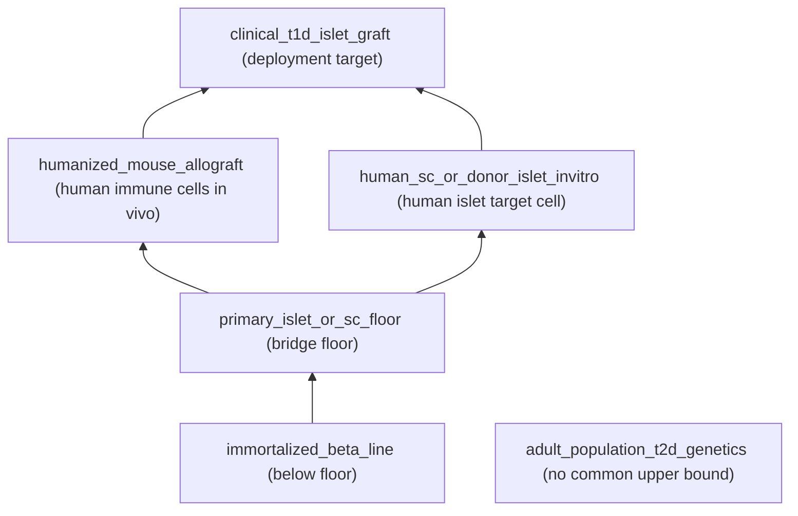

# Context–Evidence Graph (CEG): In-Context Multi-Study Scientific Synthesis with Large Language Models

**Author:** `agent-kev` (https://github.com/agent-kev)  
**Contact:** kev@openislet.org

---

## Abstract

**Objective.** Insight in science often comes from seeing patterns, boundary conditions, and contradictions across hundreds or thousands of studies at once. That many full papers do not fit in a large language model's context window, and flat subject–predicate–object summaries are compact only because they discard the study arms, doses, subgroups, and experimental models that make findings comparable. This study presents the Context–Evidence Graph (CEG), a compact structured record of study findings designed so that a large, heterogeneous literature (or a compact view of it) can sit in a model's working context at once, with each finding's arms, effect size and direction, supporting and contradicting evidence, and experimental setting kept intact. The purpose is to let a model explore across studies, look for the variables that explain disagreements, reconcile conflicting results, and propose new hypotheses and concrete next experiments. Exploration at that scale needs a safeguard, because a fluent draft can cite real studies and quote real numbers while attaching a number to the wrong outcome, study arm, unit prefix, or inequality bound, or while carrying a result across an experimental or subgroup gap that the source study does not cover. CEG therefore pairs the representation with deterministic checks that run whenever a synthesis, hypothesis, or correction is written back to the shared graph. This paper formalizes the representation and evaluates that commit-time checking layer, stating what the checks guarantee and where checking of free-text sentences fails; it does not measure how much literature fits in a context window or how often exploration yields discoveries.

**Materials and Methods.** A CEG stores each reported finding as a structured record that links an intervention, population, outcome, measurement, and experimental setting to its source study (an `EvidenceAtom`). Each record names every study arm in the comparison (an explicit multi-arm contrast); states its measurement in one of five mutually exclusive formats, namely an exact value, a relative change, an interval, a censored bound, or a non-numeric outcome (a five-way disjoint-union quantity type); and is placed on a multi-dimensional map of experimental settings, such as mouse in vivo versus human tissue ex vivo versus clinical trial, rather than on a single 1-to-5 evidence ladder (a coordinate in a finite product partial order of contexts). Each cross-study conclusion is a claim that cites both the findings that support it and the findings that contradict it, and a proposal to carry a result across an experimental gap must name the follow-up experiment that would test it. Corrections made after extraction are kept in a reversible, checksum-verified edit log over exact-decimal JSON records (a state-guarded, invertible `JSONPatch` ledger, `RFC 6901`/`RFC 6902`, over canonicalized float-free JSON, `RFC 8785`). When anything is committed to the shared graph, a two-layer verifier checks six invariants, each computable in polynomial time: every reference resolves and every record matches the curated corpus in both directions (referential closure and bidirectional atom-to-corpus binding, $I_1$); the edit log replays forward and backward (bijective ledger replay, $I_2$); every stated number, unit, arm, and direction is grounded at three levels, namely Unicode-hardened lexical tokens ($I_3^{\text{tok}}$), depth-0 per-clause contrast and polarity rules ($I_3^{\text{clause}}$), and exact seven-coordinate typed propositions ($I_3^{\text{typed}}$); results move between experimental settings only where the declared ordering allows (partial-order transfer gating, $I_4$); nothing is promoted directly from an undigitized figure or an unverified source (a primary-source digitization gate, $I_5$); and supporting and counter-evidence stay disjoint, with claim attestations and locks on non-prose metadata ($I_6$). The study evaluates a zero-dependency Python reference implementation across exhaustive finite-domain self-tests, a constructive synthetic benchmark of 1,931 cases (1,521 adversarial, 410 valid) from 199 distinct templates—including 43 sentences from an independent adversarial pass and 48 gauntlet probes—and a primary-source evaluation on 12 peer-reviewed PubMed studies (31 `EvidenceAtom`s) spanning idiopathic pulmonary fibrosis, heart failure, and thoracic oncology. All of these experiments test the commit-time checks. A worked example (§5) carries ten findings from eight peer-reviewed studies on islet replacement for type 1 diabetes through extraction, classification against a clinical target setting, logged correction, and the decision on each candidate claim. A case study then applies the representation and the checks to a 12 November 2026 snapshot of the production corpus those studies come from, of 1,151 type 1 diabetes studies (§6.9): it reports the snapshot's size and structure and replays its 106-event curation ledger through the reference verifier with tamper controls.

**Results.** In brief, the formal guarantees held on every exhaustive test; the full verifier rejected every adversarial case in the core, stress, red-team, and gauntlet suites and in the real-text synthesis track; and the free-text lint showed its two predicted limits, namely wording errors it cannot catch and true sentences it refuses. In detail: (i) State-guarded ledger replay is deterministic, invertible, and tamper-evident (Proposition 1; 182 tampers tried across 15 kinds, 0 accepted), while Layer-1 structure-only verification (`check_top_digests=False`) rejects 26/26 structural tampers without consulting any precomputed digest. (ii) Direct quantitative promotion is sound relative to the declared context partial order, and no scalar evidence ranking is both sound and complete once incomparable models exist (Theorem 1; 0 disagreements across 26,344 ordered context pairs, and 0 faithful scalar rankings among 46,656 assignments). (iii) Any surface prose verifier reading only citations, numerals, units, and polarity cues returns identical verdicts on a true pooled-citation sentence and its endpoint-misbound twin (Theorem 2; Corollary 2.1 verified across 242/242 canonical renderings). (iv) Typed proposition verification accepts a unique proposition per atom up to arm-set ordering and ASCII case (Theorem 3; 133/133 single-coordinate mutants rejected). Across synthetic suites, the full `V3` verifier rejects 600/600 core, 600/600 stress, 43/43 red-team, and 38/38 gauntlet adversarial cases while accepting 200/200 core and 10/10 gauntlet valid controls, and rejects 1,161/1,161 record-level adversarial controls outside the residual suite under a Mode B self-attesting adversary that recomputes claim attestations after tampering (60/60 non-prose metadata tampers rejected). On stress valid controls it accepts 100/200 (refusing pooled citations and unmodeled derived or dispersion numerals), and on the residual open-class prose suite it rejects 20/240 (catching pooled `R1` headers while leaving 220/240 single-tuple endpoint renamings and unlisted lexical inversions open as predicted). On the 12-study PubMed evaluation, `V3` accepts 6/36 and refuses 30/36 verbatim abstract sentences (most often because of inline confidence intervals, hazard ratios, event denominators, and publisher thin spaces), while accepting 24/24 valid grounded synthesis records and rejecting 60/60 adversarial clinical synthesis defects in both normal and Mode B self-attesting evaluation. At production scale (1,151 studies, 14,105 outcomes), the reference verifier accepts the complete 106-event curation ledger and rejects 5/5 structural tampers of it without consulting any digest; in this snapshot none of the outcomes is certified against its primary source, and the settled corpus occupies 20,412,758 bytes of canonical JSON (§6.9).

**Conclusion.** A CEG is a way to put a large structured literature in front of a language model at once and let it explore freely, while a deterministic gate checks what is written back. The gate gives exact guarantees for structured (typed) claims, for reversible edit logs, and for transfers between experimental settings on the declared context map, which is where swapped arms, unit mix-ups, and unstated leaps such as mouse-to-human are stopped. Free-text sentences are only linted, conservatively, with measured blind spots and a measured refusal rate on raw clinical prose, so decisions should rest on the typed claims. The experiments establish this integrity layer as a foundation for discovery workflows. A production corpus of 1,151 studies shows the representation and its correction log operating at scale, and shows what remained open at the time of the snapshot: its outcomes were not certified against primary sources, and its full serialization is of the order of millions of tokens. How well exploration over a CEG generates sound hypotheses remains to be evaluated.

**Keywords:** AI for science; hypothesis generation; in-context multi-study synthesis; evidence graphs; translational research; claim verification; provenance

---

## 1. Introduction

Scientific breakthroughs often come from seeing patterns, boundary conditions, and contradictions across hundreds or thousands of studies at once: an effect that appears only at one disease stage, a treatment that works in mice but not in human tissue, two trials that disagree because they enrolled different patients. Large language models (LLMs) can reason over whatever is placed in their context window, but a literature rarely fits there in a usable form. Full papers are long, so even a modest collection exceeds or clutters the window, while flat knowledge-graph triples of the form subject–predicate–object are compact but strip away the study arms, doses, subgroups, and experimental models that make two findings comparable. Context–Evidence Graphs (CEGs) are designed to sit between these extremes. Quantitative evidence in biomedicine and engineering comes from heterogeneous sources: cell assays, animal disease models, explanted human tissue, subgroup analyses, and randomized clinical trials. A CEG condenses each reported finding into a small structured record that keeps its study arms, measurement unit, statistic, sample size, and experimental context, and it records each cross-study conclusion together with the findings that support it and the findings that contradict it. The aim is that a large, heterogeneous body of evidence, or a compact view of it, can be loaded into a model's working context at once, so that the model can compare results across studies, look for the variables that explain disagreements, and propose new hypotheses together with the experiments that would test them.

To see both the opportunity and the hazard in plain terms, consider synthesizing thousands of studies on preserving or replacing insulin-producing beta cells in type 1 diabetes. Across that literature, candidate therapies routinely reverse high blood glucose in newly diabetic mice, whereas experiments on donated human pancreatic islets kept alive in culture test genuine human cells without a bloodstream or an active autoimmune attack, and clinical trials span newly diagnosed children who retain residual insulin production through adults with longstanding disease receiving systemic immunosuppression. Distilling each paper into compact, structured study arms, doses, patient groups, follow-up windows, and measured outcomes allows a language model to hold thousands of structured findings in working memory at once—comparing results across an entire literature to notice, for example, whether an intervention succeeds only before beta-cell loss is complete or reverses direction under a particular immunosuppressive regimen. Yet at that scale, a fluent synthesis that swaps active and control C-peptide values, confuses a micromolar culture concentration with a clinical dose, or presents mouse reversal as established human clinical efficacy states a substantive falsehood while citing real papers and real numbers. (§5 works through ten findings from eight peer-reviewed studies on exactly this problem, §6 evaluates the framework formally and empirically on synthetic benchmarks and 12 peer-reviewed clinical and preclinical studies across idiopathic pulmonary fibrosis, heart failure, and thoracic oncology, and §6.9 reports the production corpus of 1,151 type 1 diabetes studies from which §5's findings are drawn.)

**Why large-scale in-context discovery needs a deterministic commit gate.** Exploration at this scale produces drafts: syntheses, hypotheses, and corrections that a model proposes to write back to the shared graph. LLMs and retrieval-augmented generation (RAG) pipelines draft fluent quantitative syntheses rapidly [1–3], and their surface citations and numerals often appear genuine: the cited papers exist and the quoted numbers occur somewhere in those papers. Auditing whether each number remains bound to the right outcome, arm, unit scale, inequality direction, and target population is slow, and automated factuality evaluators largely leave that structural binding unchecked. If such drafts are saved unchecked, each error becomes part of the evidence that the next round of exploration reads. The characteristic errors recombine true material from cited papers rather than inventing citations outright:

1. **Mixing numbers across outcomes or across cited studies.** A study reports a target biomarker reduction ($29.4\ \text{ng/mL}$) alongside a slice viability control ($96.2\%$), or one sentence cites three trials in sequence, clause by clause. Attaching $96.2$ to the biomarker, rotating values among the three cited clauses ($A \to B \to C \to A$), or copying one clause's number into a second clause while keeping it in the first all pass a check that only asks whether each number appears somewhere in the cited study or sentence (a study-wide or sentence-wide bag-of-numbers check).
2. **Swapping treatment and control arms or misreading negated bounds.** The pair of numbers $(29.4, 48.6)$ is kept but assigned to the wrong arms, so the treatment value is reported for the comparator and the comparator value for the treatment. The same swap can hide inside a comma-separated aside (an appositive), as in *"the placebo arm had a change, $-28.5\ \text{mL}$, compared with treatment"*, where the number between the commas belongs to the treatment arm but reads as the placebo's. Or a negated bound is read without flipping it: `not < 5%` means at least 5%, and `never > 28 days` means at most 28 days.
3. **Confusing look-alike units, symbols, or figure labels.** Simple pattern-matching number extractors (regular expressions) miss numbers written as words (*tripled*, *sixty-four percent*) and as fraction characters (vulgar fractions); are fooled by invisible or combining Unicode characters that split a number (`U+0301`, `U+20DD`) and by Cyrillic or Greek letters that look identical to Latin ones (homoglyphs) [30, 45]; merge micromolar concentration (`uM`, `mM`, `nM`) with micrometre or millimetre length (`um`, `mm`, `nm`) when letter case is ignored; or mistake a figure panel label (`Fig. 28 d`) for a duration (`days`).
4. **Confusing relative percentages with raw values, or dropping third study arms.** Forcing every outcome into two slots, `(treatment, control)`, turns a $72.0\%$ relative reduction into what looks like a measured level and silently drops the active comparator arm of a three-arm study.
5. **Flattening different experimental models onto a single ranking ladder.** Evidence hierarchies with a single axis rank study designs on one ordinal scale [4]. Translational and clinical contexts vary along multiple axes simultaneously. A murine bleomycin model provides systemic pharmacokinetics and immune cell recruitment, whereas human precision-cut lung slices (PCLS) preserve aged human target biology and fibrotic matrix ex vivo without systemic circulation [5, 6]; similarly, a stage II–IIIA resected lung cancer primary analysis and an overall stage IB–IIIA population differ along a disease-stage axis even within one Phase 3 trial [43]. Contexts that cannot be ordered against each other (incomparable contexts) admit no single scalar ranking without either discarding complementary evidence or licensing unsupported extrapolation.
6. **Unrecorded post-extraction edits or unverified claims tucked into metadata.** Raw literature extractions need repair after the fact: fixing case-folded units, restoring dropped comparator arms, correcting subgroup sample sizes, or flagging Kaplan–Meier estimates read off a figure that has not been digitized. Without a reversible, checksum-guarded edit log (an invertible, digest-guarded patch ledger) and locks over the metadata fields that are not prose, edits cannot be traced back to the raw extraction, and unverified statements can be placed in fields that no check reads.

CEGs address these failure classes with one representation and one set of deterministic checks: the structured records that the model explores are the same records that the checks run against (formally, a typed hypergraph with a deterministic verification pipeline). The central design principle is a strict separation between **exact structural guarantees** and **heuristic prose linting**. A free-text sentence cannot be tied to one piece of evidence just by inspecting its surface citations, numerals, units, and polarity cues; Theorem 2 proves an exact indistinguishability barrier for that class of verifiers. CEGs therefore place every decision-bearing claim in a typed proposition, a structured statement that is compared field by field, on seven coordinates, with its `EvidenceAtom` (Theorem 3); govern movement between experimental settings by a product partial order (Theorem 1); track corrections in an edit log that replays in both directions (bijective `JSONPatch` replay, Proposition 1); and pair these exact layers with a conservative prose lint whose false-negative boundaries and verbatim clinical refusal rate are measured directly in §6.

**Design intent: explore free in context, verify at commit.** CEGs are meant to be used in two regimes, and the distinction governs how every result in this paper should be read. *Regime 1 (in-context exploration and hypothesis discovery) is the primary operating mode.* Condensing heterogeneous studies into compact `EvidenceAtom`s, with their study-arm variables, effect magnitudes and directions, and positions on the multi-axis map of experimental settings (`ContextSignature` coordinates), lets an entire multi-study outcome network sit inside a language model's context window at once. While exploring, synthesizing, and generating hypotheses, the model is intended to traverse that network freely in natural language, under no prose-lint restriction: spotting cross-study patterns, looking for moderating variables where effects differ between a claim's supporting and counter-evidence findings ($T^{+}$ versus $T^{-}$), proposing cross-model hypotheses, and drafting candidate graph additions or curation edits.

*Regime 2 (commit-time verification) is its guardrail.* Verification under $I_1$–$I_6$ sits only at the persistence and promotion boundary. It checks what is committed back to the shared graph: claim records (`SynthesisClaimRecord`s), their structured field-by-field statements (`TypedProposition`s) and evidence-anchor sentences (`prose_sentences`), and curation edits (`ReversiblePatchEvent`s). At that boundary $I_3$ catches swapped numbers, arms, and units, and $I_4$ sorts cross-setting claims into three kinds. A result whose source setting already covers the target (`DIRECT_MATCH`) may be promoted directly. A hypothesis that bridges a gap between comparable settings (a `CANDIDATE_UPGRADE` over a `BOUNDED_BRIDGE`) must carry a concrete follow-up experiment that would test every unresolved experimental gap (a `ProspectiveFalsifierGate` covering every unresolved axis). An explanation in terms of a moderating variable is recorded as a `SCOPING_QUALIFICATION`. The gate does more than tag cross-context claims: a `SUPPORTS` or `CANDIDATE_UPGRADE` record is rejected with `I4_INADMISSIBLE_CONTEXT_TRANSFER` whenever any of its supporting tuples is an `INADMISSIBLE_TRANSFER` (§4.1). The guardrail serves discovery: it keeps the shared graph clean as it grows and leaves exploration itself unrestricted.

This two-regime reading is a statement of design intent, not an empirical result. This paper formalizes the CEG representation and empirically benchmarks its Regime 2 integrity and transfer layer as the foundation for large-scale discovery workflows: every experiment in §6 evaluates the commit gate (Regime 2) only, and no experiment in this paper measures how much literature fits in a context window, the quality of upstream exploration, or the rate at which it yields discoveries.

### Contributions

1. **A compact evidence-graph representation and two-layer verification model (§3–§4).** Evidence atoms with a strict five-way disjoint-union quantity type, truncation-free multi-arm contrasts, colon-safe bibliographic tuple identifiers (`PMID:...`, `DOI:...`), product partial-order transfer gating, invertible state-guarded `JSONPatch` ledgers, non-prose surface digest locks, and two-layer verification separating structure-only closure (`Layer 1`) from cryptographic digest pinning (`Layer 2`).
2. **Formal guarantees and impossibility bounds (§4.3).** Proofs of ledger determinism, invertibility, and tamper evidence (Proposition 1); transfer soundness and scalar-ranking impossibility on incomparable context posets (Theorem 1); surface-verifier indistinguishability on pooled citations and canonical single-tuple completability (Theorem 2 and Corollary 2.1); and unique seven-coordinate exactness of the typed proposition layer (Theorem 3).
3. **Zero-dependency reference implementation, dual-mode synthetic benchmark, and primary-source PubMed evaluation (§5–§6).** A standard-library implementation (`ceg_reference.py` `v3.1`, byte-identical across Python `3.9`–`3.14` under both normal and `-O` optimized execution), exhaustive finite-domain self-tests, a 1,931-case synthetic benchmark evaluated under both raw tamper (`Mode A`) and self-attesting tamper (`Mode B`), and an empirical evaluation on 12 peer-reviewed PubMed studies across idiopathic pulmonary fibrosis (IPF), heart failure (HF), and thoracic oncology [33–44].
4. **A worked example on real studies (§5) and a production-scale case study (§6.9).** Ten findings from eight peer-reviewed studies on islet replacement for type 1 diabetes, curated into the representation, classified against a clinical target context, and submitted to the gate, with four cross-study hypotheses held behind prospective falsifier gates and four adversarial probes rejected. A dated snapshot of a corpus of 1,151 type 1 diabetes studies (14,105 outcomes) with its size and structure; a replay of its 106-event correction log through the reference verifier, with tamper controls; and a plain account of what that snapshot does not verify (no certified outcomes, a prioritized subset, language-model extraction, and a serialization of the order of millions of tokens).

---

## 2. Related Work

### 2.1 Evidence grading, indirectness, and translational validity

Systematic reviews follow PRISMA reporting standards [8] and Cochrane synthesis methodology [9], while GRADE evaluates certainty of evidence across risk of bias, inconsistency, indirectness, imprecision, and publication bias [7]. Within GRADE, indirectness captures mismatches across population, intervention, comparator, and outcome (PICO) between source studies and target clinical questions [10]. Critiques of rigid evidence pyramids emphasize that study design alone does not determine validity [4]. In preclinical-to-clinical translation, animal efficacy frequently fails to replicate in human trials [11, 31, 32]; American Thoracic Society consensus guidance on pulmonary fibrosis models explicitly notes that murine bleomycin fibrosis resolves spontaneously and recommends complementary confirmation in human fibrotic tissue such as precision-cut lung slices [5, 6]. CEGs do not replace statistical meta-analysis or clinical judgment; instead, they encode indirectness formally as a product partial order $(\mathcal{C}, \preceq_{\mathcal{C}})$, compute the exact set of unresolved axes $U(c_s, c_t)$, and block quantitative parameter promotion across unresolved or below-floor gaps.

### 2.2 Computational models of scientific claims, argumentation, and provenance

Computational claim models build on Toulmin's argument layout [12] and Dung's abstract argumentation frameworks [13]. Nanopublications link assertions to provenance graphs [14], and micropublications model attribution and support/challenge networks over biomedical statements and data figures [15]. W3C `PROV-DM` [16] and the FAIR data principles [17] standardize lineage metadata, while large biomedical knowledge graphs such as SemMedDB [18] and PrimeKG [19] aggregate subject–predicate–object triples across literature and ontologies. Because entity–relation triples omit multi-arm contrasts, exact measurement units, sample sizes, and experimental context coordinates, they cannot detect arm swaps, unit-scale folds, or subgroup-to-overall promotions. CEGs operate one level deeper, representing individual study outcomes as typed hypergraph atoms bound to a replayable corpus extraction.

### 2.3 Automated factuality and table/claim verification

Attribution frameworks such as AIS [1], FActScore [2], and ALCE [3] decompose generated text into atomic statements and score support using natural-language inference (NLI) models. In biomedical and scientific verification, SciFact checks single-sentence claims against abstracts [20], Evidence Inference classifies intervention–comparator–outcome directions in randomized trial reports [21], RobotReviewer extracts risk-of-bias judgments [22], and TabFact [23] and SciTab [24] benchmark compositional reasoning over tables. Neural entailment models handle open-ended lexical paraphrase that deterministic parsers refuse, but their verdicts are probabilistic, model-dependent, and vulnerable to subtle numerical, unit-case, or subgroup swaps. CEG verification is complementary and strictly deterministic: upstream human curators or language models extract structured records and draft claims, after which the CEG verifier enforces exact algebraic, numeric, unit, and context invariants.

### 2.4 Canonical JSON, document patching, and Unicode security

Post-extraction curation in CEGs builds on IETF `RFC 6901` JSON Pointer [25], a state-guarded restriction of `RFC 6902` JSON Patch [26], and `RFC 8785` JSON Canonicalization Scheme (JCS) [27] restricted to float-free trees so decimal quantities never pass through IEEE-754 binary floating-point conversion. Lexical normalization and homoglyph defenses draw on Unicode Technical Report #36 (*Unicode Security Considerations*, Revision 15) [30] and its active normative companion, Unicode Technical Standard #39 (*Unicode Security Mechanisms*, Version 18.0.0) [45].

---

## 3. Formal Model

Informally, a CEG represents each reported study finding as a self-contained, unit-aware building block (`EvidenceAtom`), locates its experimental setting on a multi-axis map of contexts rather than a single ranking ladder, records every post-extraction correction as a reversible edit, and represents each cross-study conclusion as a hyperedge connecting supporting and opposing findings. Three of these pieces do more than block errors. A claim's supporting and counter-evidence anchors ($T^{+}$ and $T^{-}$) record where studies disagree, which is how the graph represents scientific anomalies. The multi-axis context map (`ContextSignature`) records the setting in which each finding holds, which is how it represents boundary conditions. The `ProspectiveFalsifierGate` records a concrete next experiment (which arms to compare head to head, on which readout, against what pass threshold) for testing a hypothesis that crosses experimental models. Formally, all CEG structures are finite and serialize to canonical float-free JSON (`RFC 8785`, rejecting `NaN` and `±Infinity` on parse, and integers too large for a double-precision number to hold exactly). Continuous and discrete measurement magnitudes are stored as exact ASCII decimal strings and compared via arbitrary-precision `Decimal` arithmetic.

**Key terms in plain language.** The definitions below use the following names, which are also the names used in the reference implementation.

- **`EvidenceAtom`**: one reported finding from one study, stored with its arms, numbers, unit, statistic, sample size, experimental setting, and a pointer to the source passage.
- **`ContextSignature`**: the experimental setting of a finding or of a claim, given as one value on each axis of the context map (for example model system, disease stage, dosing, and endpoint).
- **Transfer class**: the answer to the question of whether a finding from one setting can speak to another. It is `DIRECT_MATCH` when the source setting covers the target, `BOUNDED_BRIDGE` when a gap remains that a named experiment could close, and `INADMISSIBLE_TRANSFER` when the gap cannot be bridged.
- **`SynthesisClaimRecord`**: one cross-study conclusion or hypothesis, together with the findings that support it ($T^{+}$) and the findings that count against it ($T^{-}$).
- **`TypedProposition`**: the structured, field-by-field form of what a claim states about one finding. The exact checks compare this form.
- **Evidence-anchor sentences (`prose_sentences`)**: the free-text sentences attached to a claim for human readers. They are linted conservatively and are not verified exactly.
- **`ProspectiveFalsifierGate`**: the follow-up experiment attached to a bridging hypothesis, naming the arms to compare, the readout, and the pass threshold.
- **`ReversiblePatchEvent`**: one logged correction to the extracted data, which can be replayed forward or undone.
- **Invariants $I_1$–$I_6$ and the two layers**: the six conditions that a commit must satisfy (§4.1). Layer 1 checks the content itself, and Layer 2 adds comparisons against stored checksums.

### 3.1 Product context partial order and transfer classifier

Let $D = \{1, \dots, d\}$ index experimental or clinical validity axes (for example, *model system*, *disease chronicity or stage*, *dosing and exposure*, and *endpoint maturity*).

*In plain terms:* each experimental setting is a point on several independent axes (for example model system, disease stage, dosing, and endpoint); a result may be carried directly from one setting to another only when the source setting covers the target on every axis, and otherwise the definition says exactly which axes remain open and whether the gap can be bridged at all.

**Definition 1 (product context poset and transfer classifier).** For each axis $k \in D$, let $(\mathcal{C}_k, \preceq_k)$ be a finite partially ordered set (reflexive, antisymmetric, and transitive), where $x \preceq_k y$ encodes the explicit domain judgment that condition $y$ dominates or covers condition $x$ toward deployment validity on axis $k$. Incomparable elements $x \parallel_k y$ represent complementary experimental models or non-nested patient strata. The product context space is

$$
\mathcal{C} = \prod_{k=1}^{d} \mathcal{C}_k, \qquad c \preceq_{\mathcal{C}} c' \iff \forall k \in D:\ c_k \preceq_k c'_k .
$$

Given a source context $c_s \in \mathcal{C}$ and a target context $c_t \in \mathcal{C}$, the *unresolved axis set* is

$$
U(c_s, c_t) = \{\, k \in D : c_{t,k} \not\preceq_k c_{s,k} \,\}.
$$

Elements $x, y \in \mathcal{C}_k$ have a *common upper bound*, written $\mathrm{cub}_k(x, y)$, iff $\exists z \in \mathcal{C}_k$ such that $x \preceq_k z$ and $y \preceq_k z$. Let $b: B \to \bigcup_{k \in B} \mathcal{C}_k$ assign to a subset of axes $B \subseteq D$ a minimum *bridge floor* $b(k) \in \mathcal{C}_k$. The three-way transfer classifier $\tau_b: \mathcal{C} \times \mathcal{C} \to \{\texttt{DIRECT\_MATCH}, \texttt{BOUNDED\_BRIDGE}, \texttt{INADMISSIBLE\_TRANSFER}\}$ is

$$
\tau_b(c_s, c_t) = \begin{cases}
\texttt{DIRECT\_MATCH} & \text{if } U(c_s, c_t) = \emptyset, \\[4pt]
\texttt{INADMISSIBLE\_TRANSFER} & \text{if } \exists k \in U(c_s, c_t):\ \neg\,\mathrm{cub}_k(c_{s,k}, c_{t,k}) \ \lor \ \big(k \in B \land b(k) \not\preceq_k c_{s,k}\big), \\[4pt]
\texttt{BOUNDED\_BRIDGE} & \text{otherwise.}
\end{cases}
$$

`DIRECT_MATCH` holds iff $c_t \preceq_{\mathcal{C}} c_s$ on every axis. `BOUNDED_BRIDGE` holds when one or more axes remain unresolved ($U \neq \emptyset$), yet on every unresolved axis $c_{s,k}$ shares a common upper bound with $c_{t,k}$ and clears any declared bridge floor $b(k)$, permitting conditional synthesis behind an explicit prospective falsifier gate. `INADMISSIBLE_TRANSFER` holds whenever an unresolved axis lies below its bridge floor or on a disconnected branch with no common upper bound. Poset axioms and floor membership are checked algorithmically as part of graph integrity ($I_1$).

*Figure 1. Hasse diagram of the six-element `model_system` axis in the worked type 1 diabetes example (§5). `humanized_mouse_allograft` and `human_sc_or_donor_islet_invitro` are incomparable ($\parallel$), both clear `primary_islet_or_sc_floor`, and both share `clinical_t1d_islet_graft` as a common upper bound (`BOUNDED_BRIDGE`), whereas `immortalized_beta_line` sits below the floor and `adult_population_t2d_genetics`, a population genetic association in adults without a transplant, shares no upper bound with the target (`INADMISSIBLE_TRANSFER`).*

### 3.2 Disjoint-union quantities, multi-arm contrasts, and colon-safe evidence atoms

*In plain terms:* every measurement is written in exactly one of five formats (a value with its unit, a relative change with its direction, an interval, a bound such as more than 28 days, or an explicit statement that no number is available), and the fields of the other four formats must be empty, so a percentage change can never be mistaken for a measured level.

**Definition 2 (strict disjoint-union quantity type).** Every quantitative slot takes a value in the five-variant disjoint union $\mathcal{Q} = \mathcal{Q}_{\text{level}} \sqcup \mathcal{Q}_{\text{rel}} \sqcup \mathcal{Q}_{\text{int}} \sqcup \mathcal{Q}_{\text{cens}} \sqcup \mathcal{Q}_{\text{miss}}$, where every inactive variant's fields must be `None` and every literal $v$ must be a canonical ASCII decimal matching `-?(?:0|[1-9][0-9]*)(?:\.[0-9]+)?` in full (an optional minus sign, no plus sign, no leading zero, no exponent, ASCII digits only):

- **`point_level`**: $(\rho, v, u, d_u)$ with $\rho \in \{=, \approx\}$, non-empty unit $u$, non-empty unit dimension $d_u$, and `lower = upper = change_direction = missing_reason = None`.
- **`relative_change`**: $(\rho, v, u, \delta)$ with $\rho$ any of the six relation operators of `RELATION_OPS` (`=`, `≈`, `<`, `<=`, `>`, `>=`), $u \in \{\%, \texttt{fold}, \texttt{ratio}, \texttt{log2\_fc}\}$, mandatory direction $\delta \in \{\texttt{increase}, \texttt{decrease}, \texttt{neutral}\}$, and `lower = upper = missing_reason = None`.
- **`interval_bound`**: $([v_{\text{lo}}, v_{\text{hi}}], u, d_u)$ with $v_{\text{lo}} \le v_{\text{hi}}$ as exact `Decimal`s, non-empty $u$ and $d_u$, and `relation = value = change_direction = missing_reason = None`.
- **`censored_observation`**: $(\rho, v, u)$ with strict inequality or bound operator $\rho \in \{>, \ge, <, \le\}$, non-empty $u$, and `lower = upper = change_direction = missing_reason = None`.
- **`missing_numeric`**: $(\texttt{missing\_reason})$ with non-empty reason string and `relation = value = lower = upper = unit = unit_dimension = change_direction = None`.

*In plain terms:* a comparison must list every study arm that the source reports for that outcome, so the third arm of a three-arm trial cannot be silently dropped, and an `EvidenceAtom` bundles one outcome's comparison, values, statistic, sample size, experimental setting, and pointer back to the source passage into a single record.

**Definition 3 (truncation-free multi-arm contrast and `EvidenceAtom`).** Let $\mathcal{V}(s)$ denote the declared arm variables of study $s$, and $\mathrm{Mentions}(t) \subseteq \mathcal{V}(s)$ the arm variables named in the primary source for outcome tuple $t$. A *multi-arm contrast* $\gamma = (A_{\text{focal}}, A_{\text{comp}}, \kappa)$ over duplicate-free tuples of arm IDs satisfies: (1) $A_{\text{focal}} \neq \emptyset$, $A_{\text{focal}} \cup A_{\text{comp}} \subseteq \mathcal{V}(s)$, and $A_{\text{focal}} \cap A_{\text{comp}} = \emptyset$; (2) cardinality agreement with $\kappa \in \{\texttt{single\_arm}, \texttt{pairwise}, \texttt{multi\_arm\_joint}\}$ ($(|A_{\text{focal}}|, |A_{\text{comp}}|) = (1, 0)$ for `single_arm`, $(1, 1)$ for `pairwise`, and $|A_{\text{focal}}| + |A_{\text{comp}}| \ge 3$ for `multi_arm_joint`); and (3) *non-truncation*: $\mathrm{Mentions}(t) \subseteq A_{\text{focal}} \cup A_{\text{comp}}$.

Outcome tuple identifiers take the right-anchored form $t = s{:}o$, partitioned at the **rightmost** colon (`split_outcome_tuple`, `rsplit(":", 1)`), where the outcome local identifier $o$ is the non-empty remainder and therefore contains no colon; to be recognized as a citation in prose (`TUPLE_RE`) it must have the form `O\d+[A-Za-z0-9_-]*` (`O1`, `O2_itt`). The study/document prefix $s$ may carry standard bibliographic namespace colons and slashes (`S104`, `PMID:24836310`, `DOI:10.1056/NEJMoa1402582`). An `EvidenceAtom` is the 13-tuple

$$
a = \big(\texttt{ATOM:}t,\ t,\ s,\ \mathrm{ep},\ c_a,\ \gamma,\ q_{\text{focal}},\ q_{\text{comp}},\ \mathrm{stat},\ n,\ p_{\text{int}},\ \pi,\ \mathrm{prov}\big),
$$

with balanced-bracket endpoint name $\mathrm{ep}$ free of forbidden Unicode, context signature $c_a \in \mathcal{C}$, $q_{\text{focal}} \in \mathcal{Q}$, $q_{\text{comp}} \in \mathcal{Q} \cup \{\bot\}$, statistic kind $\mathrm{stat}$ from the closed vocabulary `STATISTIC_KINDS` (`mean`, `median`, `proportion`, `rate`, `rate_ratio`, `hazard_ratio`, `odds_ratio`, `difference`, `fold_change`, `qualitative`), non-negative integer sample size $n \in \mathbb{Z}_{\ge 0} \cup \{\bot\}$ (`bool` and `float` rejected), optional interval/$p$-value string $p_{\text{int}}$, closed polarity $\pi \in \{\texttt{favorable}, \texttt{unfavorable}, \texttt{neutral\_or\_mixed}, \texttt{unresolved}\}$ (`ATOM_POLARITIES`), and `ProvenancePin` $\mathrm{prov} = (\mathrm{doc\_id}, \mathrm{loc}, \mathrm{quote}, \texttt{requires\_figure\_digitization}, \texttt{primary\_pdf\_verified})$. Qualitative outcomes require `missing_numeric`, and outcomes with `requires_figure_digitization = True` cannot carry a `point_level` quantity at all (neither $=$ nor $\approx$).

### 3.3 Hypergraph claims, non-prose surface locks, and bijective patch ledger

*In plain terms:* the graph consists of the context map, the studies, their arms, the findings, and the claims; each claim is a record that points to the findings supporting it and the findings against it, says what kind of claim it is and which setting it is about, and carries both its free-text sentences and its field-by-field structured statements.

**Definition 4 (Context–Evidence Graph and synthesis claim hyperedge).** A CEG is $\mathcal{G} = (\Lambda, \mathcal{S}, \mathcal{V}, \mathcal{A}, \mathcal{H})$. Each synthesis claim $h \in \mathcal{H}$ is a directed hyperedge

$$
h = \big(\mathrm{id},\ \omega,\ c_{\text{target}},\ T^{+},\ T^{-},\ \Sigma_{\text{prose}},\ \mathcal{P}_{\text{typed}},\ g_{\text{prosp}},\ \mathrm{prom},\ \alpha\big),
$$

connecting supporting tuples $T^{+}$ and counter-evidence tuples $T^{-}$ to a claim with closed epistemic polarity $\omega \in \{\texttt{SUPPORTS}, \texttt{CONTRADICTS}, \texttt{SCOPING\_QUALIFICATION}, \texttt{CANDIDATE\_UPGRADE}, \texttt{FALSIFIED\_GRAVEYARD}\}$ at target context $c_{\text{target}} \in \mathcal{C}$, prose sentences $\Sigma_{\text{prose}}$, typed propositions $\mathcal{P}_{\text{typed}}$, optional `ProspectiveFalsifierGate` $g_{\text{prosp}}$, promotion request flag $\mathrm{prom} \in \{\text{true}, \text{false}\}$, and optional deterministic claim-attestation digest $\alpha$ (the field `attestation_sha256`, computed by `compute_claim_attestation_sha256` over the record's structured fields, cited tuples, and extracted numeric mentions). These ten components are the ten fields of `SynthesisClaimRecord`. When a record is serialized as an envelope (`record_to_envelope`), every key outside `ACTIVE_PROSE_KEYS = {"prose_sentences"}` is canonicalized and bound into the non-prose surface digest $H_{\text{meta}} = H(h \setminus \Sigma_{\text{prose}})$ (`non_prose_surface_sha256`). $H_{\text{meta}}$ is not a field of the record: it is held beside the record and supplied to the verifier as the expected value, so unverified claims cannot be smuggled inside auxiliary metadata strings.

*In plain terms:* every correction made after extraction is logged as one small edit to one study's record, with the old value, the new value, a reason, and a checksum of that study's record before and after, so the whole history can be replayed forward to the curated data or backward to the raw extraction.

**Definition 5 (state-guarded bijective `JSONPatch` ledger).** Let $D_0$ be the raw extracted corpus JSON and $D_m$ the settled corpus JSON. A curation ledger $\mathcal{L} = (e_1, \dots, e_m)$ is a sequence of `ReversiblePatchEvent`s

$$
e_i = (\mathrm{id}_i,\ s_i,\ \mathrm{ptr}_i,\ v_i^{\text{old}},\ v_i^{\text{new}},\ \mathrm{rat}_i,\ H_i^{\text{pre}},\ H_i^{\text{post}})
$$

satisfying: (a) $\mathrm{ptr}_i$ is a canonical `RFC 6901` JSON Pointer (array indices match `0` or `[1-9][0-9]*`, forbidding `-1` or leading-zero aliases) addressing an existing mutable target strictly inside study $s_i$'s record and never altering `study_id`; (b) $v_i^{\text{old}} \neq v_i^{\text{new}}$ under canonical `RFC 8785` encoding (forbidding no-op padding); (c) event IDs $\mathrm{id}_i$ are pairwise distinct, and each event's identifier, study identifier, pointer, and rationale carry no forbidden Unicode (`I2_FORBIDDEN_UNICODE_IN_LEDGER_STRING`); and (d) $H_i^{\text{pre}}$ and $H_i^{\text{post}}$ equal the `RFC 8785` SHA-256 digests of study $s_i$'s isolated JSON subtree immediately before and after replacing $v_i^{\text{old}}$ with $v_i^{\text{new}}$.

---

## 4. Verification Invariants, Formal Guarantees, and Prose Lint Boundaries

The checks in this section run only when something is committed to the shared graph (Regime 2). They exist to keep that graph trustworthy as exploration adds to it, and two of them also preserve what exploration found: $I_4$ requires a hypothesis that crosses experimental models to carry its `ProspectiveFalsifierGate`, the concrete experiment that would test it, and $I_6$ keeps a claim's supporting and counter-evidence anchors ($T^{+}$ and $T^{-}$) disjoint, so recorded disagreements between studies stay visible instead of being merged away.

### 4.1 Six invariants and two-layer package verification

*In plain terms:* a commit is accepted only if six conditions all hold. Every reference points to something that exists, and the graph matches the curated data exactly ($I_1$). The edit log replays forward and backward ($I_2$). Every number, unit, arm, and direction in the claim matches the finding it cites ($I_3$). A result is carried to another experimental setting only where the context map allows, and a bridging hypothesis names the experiment that would test it ($I_4$). Nothing is promoted from a figure that has not been digitized or from a source that has not been verified ($I_5$). Evidence for and against a claim stays separate, and no unchecked text can hide in metadata ($I_6$).

A CEG package and synthesis claim pass verification iff all six invariants hold:

- **$I_1$ (graph integrity, referential closure, and bidirectional corpus binding).** $\Lambda$ satisfies poset axioms; every context coordinate in $\mathcal{S}$, $\mathcal{A}$, and $c_{\text{target}}$ belongs to $\Lambda$; every `EvidenceAtom` satisfies Definitions 2–3, with no forbidden Unicode in its identifier, endpoint, unit, arm-identifier, interval/$p$-value, and provenance strings, balanced brackets in its endpoint name and units, and no confusable homoglyph in its endpoint name, units, and arm identifiers; every anchor tuple in $T^{+} \cup T^{-}$ resolves in $\mathcal{A}$ (`I1_DANGLING_ANCHOR_TUPLE`), and every tuple cited in $\Sigma_{\text{prose}}$ or $\mathcal{P}_{\text{typed}}$ belongs to the record's declared anchor set $T^{+} \cup T^{-}$ (`I1_UNDECLARED_PROSE_TUPLE`, `I1_UNDECLARED_PROPOSITION_TUPLE`); record and proposition identifiers carry no forbidden Unicode (`I1_FORBIDDEN_UNICODE_IN_RECORD_ID`, `I1_FORBIDDEN_UNICODE_IN_PROPOSITION_ID`); and `verify_atoms_bound_to_corpus` confirms **bidirectional parity** between $\mathcal{G}$ and $D_m$: no orphan study or outcome exists on either side (`I1_STUDY_WITHOUT_CORPUS_RECORD`, `I1_CORPUS_STUDY_WITHOUT_GRAPH_RECORD`, including zero-outcome corpus entries), and every field recorded in $D_m$ (endpoint, quantity kind, relation, exact value/interval bounds, unit, change direction, focal/comparator arms, statistic kind, sample size, and provenance flags) agrees exactly with $\mathcal{A}$. Provenance flags must be genuine booleans: `EvidenceAtom.validate` refuses any other type (`PROVENANCE_BOOLEAN_MUST_BE_BOOL`, reported as `I1_ATOM_VALIDATION_ERROR`), the corpus comparison refuses a non-boolean flag in $D_m$ (`I1_ATOM_CORPUS_FIELD_MISMATCH`), and the claim check refuses a cited atom whose flag is not a boolean (`I1_INVALID_PROVENANCE_BOOLEAN`). The promotion request flag of a claim must likewise be a boolean (`I1_INVALID_PROMOTION_BOOLEAN`).
- **$I_2$ (bijective ledger replay).** Forward replay of $\mathcal{L}$ from $D_0$ satisfies all per-step pre/post study digests and old-value guards to produce $D_m$, and reverse replay of $e_m^{-1}, \dots, e_1^{-1}$ from $D_m$ reproduces $D_0$.
- **$I_3$ (three-tier proposition grounding).**
  - **$I_3^{\text{tok}}$** (Unicode-hardened lexical & role-typed token grounding): prose contains no forbidden invisible, combining/enclosing, non-ASCII space, or confusable-script characters; no non-canonical numeral evasions; and every extracted numeric/unit mention is licensed by its scoped atom(s) in a role consistent with its unit and SI prefix case (§4.2).
  - **$I_3^{\text{clause}}$** (per-clause contrast, arm-order, inequality, and polarity lint): every depth-0 clause carrying tuple citations grounds its mentions in *that clause's* cited tuple pool (rejecting pooled multi-tuple numeral clauses under strict mode), enforces conservative contrast-connector requirements on multi-arm clauses, and checks arm attribution, negated inequality inversion, and directional polarity cues (§4.2).
  - **$I_3^{\text{typed}}$** (exact seven-coordinate proposition homomorphism): every $p \in \mathcal{P}_{\text{typed}}$ matches its target atom on all seven coordinates with duplicate-free arm tuples (Theorem 3), and $\mathrm{prom} = \text{true}$ requires $\mathcal{P}_{\text{typed}}$ to cover every $t \in T^{+}$.
- **$I_4$ (partial-order transfer and falsifier-gate completeness).** Positive claims ($\omega \in \{\texttt{SUPPORTS}, \texttt{CANDIDATE\_UPGRADE}\}$) require $T^{+} \neq \emptyset$ and forbid $\tau_b(c_a, c_{\text{target}}) = \texttt{INADMISSIBLE\_TRANSFER}$ on any $t \in T^{+}$. Direct promotion ($\mathrm{prom} = \text{true}$) requires $\omega = \texttt{SUPPORTS}$ and $\tau_b(c_a, c_{\text{target}}) = \texttt{DIRECT\_MATCH}$ for every $t \in T^{+}$. Whenever $U_{\cup} = \bigcup_{t \in T^{+}} U(c_a, c_{\text{target}}) \neq \emptyset$ on a `CANDIDATE_UPGRADE` (or whenever a `ProspectiveFalsifierGate` is attached), the gate must name only declared axes of $\Lambda$, cover $U_{\cup}$, specify two distinct non-empty head-to-head arms, and state a non-empty primary readout and a non-empty pass threshold (the gate carries one free-text readout field and one free-text threshold field, `quantitative_pass_threshold`; the verifier checks that both are present and does not parse a unit or a number from them). The three failure codes are `I4_MISSING_PROSPECTIVE_FALSIFIER_GATE` (no gate on a `CANDIDATE_UPGRADE` with $U_{\cup} \neq \emptyset$), `I4_INCOMPLETE_PROSPECTIVE_FALSIFIER_AXES` (the gate does not cover $U_{\cup}$), and `I4_INVALID_PROSPECTIVE_FALSIFIER_GATE` (a malformed gate). A non-promoting `SUPPORTS` record over a `BOUNDED_BRIDGE` needs no gate and receives the terminal decision `QUALITATIVE_SCOPING_ONLY`; transfer is classified over $T^{+}$ only, so `CONTRADICTS`, `SCOPING_QUALIFICATION`, and `FALSIFIED_GRAVEYARD` records are not rejected for an inadmissible source.
- **$I_5$ (primary-source and digitization gate).** Direct promotion ($\mathrm{prom} = \text{true}$) is rejected if any $t \in T^{+}$ has `requires_figure_digitization = True` or `primary_pdf_verified = False`. Direct promotion is also rejected when no supporting atom holds a numeric quantity, that is, when every cited atom is typed `missing_numeric` (`I5_ILLEGAL_QUANTITATIVE_PROMOTION_OF_MISSING_NUMERIC`).
- **$I_6$ (anchor disjointness, claim attestations, and non-prose surface locks).** $T^{+} \cup T^{-} \neq \emptyset$, $T^{+} \cap T^{-} = \emptyset$, any populated `attestation_sha256` equals the freshly recomputed claim-attestation digest (`compute_claim_attestation_sha256`; a mismatch raises `I6_STALE_CLAIM_ATTESTATION`), any optional `record_envelopes` sequence supplied to `verify_ceg_package` or `compute_ceg_section_digests` corresponds bijectively in order and canonical core-field values to the verified `records` (`verify_envelopes_bound_to_records`, raising `I6_ENVELOPE_RECORD_COUNT_MISMATCH` or `I6_ENVELOPE_RECORD_MISMATCH`), and any serialized claim envelope matches the expected non-prose surface digest passed to `verify_non_prose_surface_lock` across 100% of keys outside `ACTIVE_PROSE_KEYS` (`I6_NON_PROSE_METADATA_TAMPER`). The attestation comparison is evaluated without short-circuiting the semantic $I_1$–$I_5$ checks. Within `verify_ceg_package`, both digest comparisons (plus envelope `attestation_sha256` binding) belong to Layer 2 below; the anchor, disjointness, and non-digest envelope-to-record binding conditions are checked in both layers.

**Two-layer package verification (`verify_ceg_package`).** In plain terms, Layer 1 checks the content itself and rejects structural or semantic tampering even if every stored checksum has been deleted, and Layer 2 adds checksum comparisons that catch changes the content checks cannot see, such as a reworded rationale. To ensure that cryptographic digests never substitute for structural checking, package verification separates into two explicit layers:
- **Layer 1 (`check_top_digests=False`, structure-only closure):** Verifies graph integrity, every pointer and old-value guard of the ledger, exact equality of the forward- and reverse-replayed corpora with $D_m$ and $D_0$, bidirectional atom-to-corpus parity, and the non-digest conditions of $I_1$ and $I_3$–$I_6$ on every claim record, **without** consulting any precomputed digest: the per-event study digests, the claim-attestation digests, and the section digests are all ignored. Any structural, catalogue, value, dangling-reference, or semantic tamper fails Layer 1 even if every stored digest is omitted or zeroed.
- **Layer 2 (`check_top_digests=True`, digest locks):** Additionally checks the per-event study `pre`/`post` digests (completing $I_2$ as defined above), each record's `attestation_sha256`, and, when section digests are supplied, the five locks computed by `compute_ceg_section_digests`: `initial_corpus_sha256` $= H(D_0)$, `settled_corpus_sha256` $= H(D_m)$, `ledger_sha256` $= H(\mathcal{L})$, `atoms_sha256`, and `records_non_prose_sha256`. Layer 2 catches what replay of values cannot see: reordered same-study events and stale attestations through the per-event and attestation digests, and rationale rewording, event renaming, inserted edit-and-revert pairs, and metadata injected outside `prose_sentences` through the section digests.

```mermaid
flowchart LR
    subgraph R1["Regime 1: in-context exploration & hypothesis discovery (primary mode; unconstrained; design intent, not evaluated)"]
        CTX["In-context multi-study graph: EvidenceAtom, ContextSignature, T+ and T-"]
        HYP["Free-form exploration and fluid hypothesis loop"]
        CTX --> HYP
        HYP --> CTX
    end
    HYP -->|"candidate commits"| CAND["SynthesisClaimRecord + TypedProposition + ReversiblePatchEvent"]
    subgraph R2["Regime 2: deterministic commit gate (guardrail; two-layer I_1 to I_6 verifier)"]
        RAW["Raw corpus D_0 (as extracted)"] -->|"I_2 forward/inverse replay"| CUR["Settled corpus D_m (after corrections)"]
        CUR -->|"I_1 bidirectional binding"| G["Typed atoms & poset G (findings & context map)"]
        TOK["I_3 tok: UTS #39 + SI units (numbers, units & scripts)"] --> CLS["I_3 clause: per-clause scope, bounds & arms (lint)"]
        CLS --> TYP["I_3 typed: 7-coordinate homomorphism (exact 7-field match)"]
        G --> TYP
        TYP --> POS["I_4 poset transfer & falsifier gate (context-gap check)"]
        POS --> PRM["I_5 digitization gate & terminal decision (primary-source check)"]
        PRM --> LOCK["Layer 2: step, attestation & section digest locks (I_6 non-prose lock, ledger digest)"]
    end
    CAND -->|"I_6 anchors & disjointness"| TOK
    CAND -->|"curation edits"| RAW
    LOCK -->|"accepted: persisted to the shared graph"| CTX
    PRM -->|"rejected: violation codes returned to context"| HYP
```

*Figure 2. Two-regime workflow and the `V3` commit verifier. Regime 1 (left) is the open-ended exploration and hypothesis-discovery loop over the in-context graph, the primary operating mode; it is a statement of design intent and is neither constrained nor evaluated in this paper. Candidate commits (`SynthesisClaimRecord`s with their `TypedProposition`s, and `ReversiblePatchEvent` curation edits) enter Regime 2, the two-layer verifier that acts as its guardrail: Layer 1 checks every structural, replay, lint, typed, and context invariant directly, and Layer 2 adds the per-step, attestation, and section digest locks. Accepted commits persist to the shared graph; rejected commits return structured violation codes to the context for iterative repair.*

### 4.2 Hardened prose lint specification ($I_3^{\text{tok}}$ and $I_3^{\text{clause}}$)

*In plain terms:* the lint reads each evidence-anchor sentence as a strict proofreader would. It refuses invisible and look-alike characters (rule 1), reads units with their exact letter case (rule 2), splits the sentence into clauses and requires each clause's numbers to come from the findings that clause cites (rule 3), flips negated bounds and requires an explicit comparison word when a clause names both arms of a multi-arm outcome (rule 4), and checks direction words such as *reduced* or *rose* clause by clause (rule 5). The lint is conservative by design: an ambiguous sentence is refused, which is why some true sentences fail (§6.4 and §6.8).

Because prose checks operate on surface strings, every rule and boundary is stated explicitly:

1. **Unicode character and script security (`UTS #39` / `UTR #36`).** `contains_forbidden_unicode` rejects format (`Cf`), control (`Cc` outside `\t`, `\n`, `\r`), surrogate (`Cs`), private-use (`Co`), unassigned (`Cn`), line/paragraph separator (`Zl`, `Zp`), and **all non-ASCII space (`Zs`)** characters (`U+00A0`, `U+2005`, `U+2009`), any default-ignorable code point, every **enclosing mark (`Me`, such as `U+20DD`)**, and any **combining mark (`Mn`/`Mc`, such as `U+0301`) that adjoins an ASCII digit, ASCII letter, decimal separator, sign, whitespace, or a string boundary** (a combining mark between two non-ASCII letters is not flagged). Separately, `contains_confusable_homoglyphs` rejects Cyrillic, Armenian, and Cherokee letters, Greek letters confusable with Latin, mathematical-alphanumeric and fullwidth look-alikes, the Kelvin and Ångström signs, and mixed-script words, both in prose (`I3_TOK_CONFUSABLE_HOMOGLYPH`, for example `PR\u041e-C3` or `r\u043ese`) and in atom endpoint names, units, and arm identifiers at $I_1$. Scientific symbols remain permitted (`±`, `×`, `–`, `µ`/`μ`), and superscript or subscript digits are accepted inside registered endpoint and unit strings (for example an endpoint `VO₂max` or a unit `mL/min/1.73 m²`); elsewhere in prose they are refused as `I3_TOK_NONCANONICAL_NUMERAL`.
2. **Case-sensitive SI units, `%` right boundaries, and designator guards.** `UNIT_TABLE` distinguishes case-sensitive SI concentration prefixes (`M`, `mM`, `uM`/`µM`, `nM`, `pM`, `fM`) from length prefixes (`m`, `cm`, `mm`, `um`/`µm`, `nm`, `pm`) without case-folding two-letter SI prefix symbols, attaches `%` cleanly before punctuation or parentheses (`94.2%.`, `94.2% (`) without trailing `\b` failure, checks both leading (`PRO-C3 (mg/mL) was 29.4`) and trailing (`concentration was 10 (um)`) parenthesized unit headers, and reads the single-letter units `d`, `h`, `l`, `m`, and `g` only when a space or hyphen separates them from their numeral (`28 d`, `28-d`; a glued `28d` is refused as `I3_TOK_NONCANONICAL_NUMERAL`), suppressing `d` and `h` after a figure/table panel designator (`Fig. 28 d`, `Table 2 h`). Lowercase `l` and `ml` are read as litres and millilitres.
3. **Depth-0 per-clause scoping and contrastive subordinators.** Multi-tuple sentences are split at bracket depth 0 across semicolons, coordinating/contrastive markers (`whereas`, `while`, `but`, and `and` or a clause comma before a citation), **and mid-sentence contrastive subordinators with or without commas (`although`, `even though`, `though`)**, while coordinating citation tails (`(C500:O2) and (C500:O1)`, `; see C500:O2 and C500:O1`) and leading `For C500:O1 and C500:O2,` headers are retained in pooled scope rather than mis-split into single-tuple fragments. Every clause carrying its own tuple citation(s) must ground its numeric/unit tokens in *that clause*'s cited tuple pool—rejecting $k$-tuple cyclic permutations ($k \ge 3$), one-way cross-clause thefts, and duplicate-token thefts even when every value appears somewhere in the sentence union.
4. **Symbolic/`never`-negated inequalities and conservative multi-arm binding.** Strict inequality extraction inverts symbolic and verbal negated bounds (`not < 5%` $\to \ge 5\%$, `not <= 5%` $\to > 5\%$, `never > 28` $\to \le 28$, `never less than 5%` $\to \ge 5\%$), and conservatively refuses residual bare numeric negation (`not 24 h`) or stacked double negation (`not never < 28 days`): the operator parser returns `AMBIGUOUS_NEGATION`, which matches no atom relation, so the clause fails with `I3_CLAUSE_INEQUALITY_MISMATCH`. On pairwise outcomes, clauses naming an unmodeled study arm alongside a bound arm fail with `I3_CLAUSE_MULTI_ARM_AMBIGUITY`; across multi-arm outcomes, clauses naming both focal and comparator arms without an explicit contrast connector (`vs`, `versus`, `compared with`, `compared to`, `relative to`, `against`, `than`, `in contrast to`, `as opposed to`, `whereas`, `while`, `but`, `even though`, `although`, `though`, `respectively`, `over` introducing an arm reference, or a `from`–`to` trajectory over the two point values) fail with `I3_CLAUSE_NON_CONTRAST_MULTI_ARM` (refusing symmetric *"Arm A and Arm B"* and parenthetical side-notes), and comma-appositive comparative arm swaps (*"the placebo arm had a change, $-20.5\ \text{mL}$, compared with treatment"*) are rejected with `I3_CLAUSE_ARM_VALUE_SWAP`.
5. **Clause-local polarity windowing.** Comparator-arm governance resets across `;` or `:` and across `and`, `but`, or `yet` followed directly by a single-token subject before the cue (`_CLAUSE_RESET_RE`), so an absent-reduction clause on a comparator (*"the reduction seen in vehicle slices was absent and PRO-C3 rose to … in treated slices"*) cannot mask an inverted verb on the focal arm (`I3_CLAUSE_DIRECTION_REVERSAL`), trailing polarity clauses after `respectively` lists are checked against all cited atoms, and cues asserted of the comparator arm while denied of the focal arm (*"seen in vehicle slices, not in treated slices"*) fail with `I3_CLAUSE_NEGATED_DIRECTION`.

### 4.3 Formal results

*In plain terms:* if the edit log checks out, replaying it forward from the raw extraction gives exactly the curated data and replaying it backward gives exactly the raw extraction; and the checksum-guarded replay fails whenever either endpoint corpus is altered while the other and the edit log are fixed, an edit is dropped or repeated, two adjacent edits to the same study are swapped, or an edit is pointed somewhere else.

**Proposition 1 (state-guarded bijective patch replay).** *If $(D_0, D_m, \mathcal{L})$ satisfies $I_2$, then unconditionally for (i), (ii), and (iii)(a),(b),(e), and absent a SHA-256 collision on `RFC 8785` canonical encodings of float-free JSON documents for (iii)(c)–(d):*
*(i) (determinism) forward replay of $\mathcal{L}$ from $D_0$ yields exactly $D_m$;*
*(ii) (invertibility) reverse replay of $(e_m^{-1}, \dots, e_1^{-1})$ from $D_m$ yields exactly $D_0$; and*
*(iii) (tamper evidence) digest-guarded replay—`verify_bijective_patch_replay` with its per-step study digests, which is $I_2$ as defined in §4.1 and what Layer 2 runs—fails for (a) any altered $D_0$ with $(D_m, \mathcal{L})$ fixed or any altered $D_m$ with $(D_0, \mathcal{L})$ fixed, (b) deletion or duplication of any event $e_k$, (c) transposition of adjacent events touching the same study, (d) replacement of $\mathrm{ptr}_k$ by any distinct pointer (including non-canonical index aliases), and (e) any pointer escaping the subtree of study $s_k$.*

*Proof.* Canonical `RFC 8785` serialization is injective on float-free JSON trees and deep-copies study subtrees so no mutable container is shared across studies. At step $i$, forward replay verifies $H(W_{i-1}[s_i]) = H_i^{\text{pre}}$ and $W_{i-1}[\mathrm{ptr}_i] = v_i^{\text{old}}$, writes $v_i^{\text{new}}$ at $\mathrm{ptr}_i$ to form $W_i$, and verifies $H(W_i[s_i]) = H_i^{\text{post}}$; exact canonical JSON comparison `_json_equal` verifies $W_m = D_m$ directly without hashing, proving (i). Because $\mathrm{ptr}_i$ addresses an existing location holding $v_i^{\text{old}}$, writing $v_i^{\text{old}}$ back into $W_i$ restores $W_{i-1}$ and satisfies the swapped guards $(H_i^{\text{post}}, H_i^{\text{pre}})$, proving (ii) by induction from $m$ down to $0$. For (iii): (a) with $(D_m, \mathcal{L})$ fixed, any $D'_0 \neq D_0$ satisfying all step guards would map by (ii) from its terminal state $W'_m$ back to $D'_0 \neq D_0$, forcing $W'_m \neq D_m$ and breaking terminal equality, and symmetrically for $D'_m \neq D_m$ with $(D_0, \mathcal{L})$ fixed; (b) since $v_k^{\text{old}} \neq v_k^{\text{new}}$, omitting or repeating $e_k$ alters $W_k[s_k]$ and breaks either the next guard on $s_k$ or terminal equality with $D_m$; (c) for adjacent events on $s_k$, absent a SHA-256 collision $H_k^{\text{pre}} \neq H_k^{\text{post}}$ because $v_k^{\text{old}} \neq v_k^{\text{new}}$, so $e_{k+1}$ encounters $H_k^{\text{pre}} \neq H_{k+1}^{\text{pre}}$; (d) non-canonical pointer tokens fail Definition 5(a) directly, while any distinct canonical pointer either fails the old-value guard, leaves two differing locations in $W_k[s_k]$ (disjoint paths), or would require a finite JSON subtree to equal a proper sub-value of itself (nested paths), breaking $H_k^{\text{post}}$ absent a SHA-256 collision (and terminal equality if unoverwritten); and (e) subtree containment is checked directly on $\mathrm{ptr}_k$. $\square$

*Remark (commuting cross-study edits and Layer-2 digest binding).* Adjacent events on *distinct* studies commute and represent the same per-study state transition; replay accepts their transposition unless event digests are hash-chained. Likewise, rewording `rationale`, renaming `event_id`, or inserting an edit followed immediately by its exact inverse preserves the map $D_0 \mapsto D_m$ and is accepted by replay, while altering $H(\mathcal{L})$ and failing Layer-2 digest verification (Table 8). Because per-event digests cover only studies touched by $\mathcal{L}$, an identical modification applied simultaneously to an unpatched study in both $D_0$ and $D_m$ also preserves the relative transition $D_0 \mapsto D_m$ under standalone replay and is caught in Layer 2 by the whole-corpus endpoint locks (`initial_corpus_sha256`, `settled_corpus_sha256`). Layer 1 verifies pointers, old-value guards, and exact equality of the replayed corpora but does not consult the per-step digests, so part (iii)(c) is not guaranteed there: adjacent events on the *same* study that edit disjoint locations also commute under value-only replay, and their transposition is accepted by Layer 1 and rejected by Layer 2.

*In plain terms:* (1) provided a result that is valid in one setting stays valid in every setting that it covers, whenever the gate allows a number to be carried directly from one setting to another the transfer is sound, and when the gate does not allow it, it names exactly the axes that fall short; (2) as soon as two settings cannot be ranked against each other, such as a mouse model and human tissue slices, no single evidence score with a cut-off can allow all of the sound transfers and only those.

**Theorem 1 (poset transfer soundness and impossibility of a faithful scalar evidence ranking).**
*(1) Suppose validity of a quantitative parameter within an endpoint family is monotone down $(\mathcal{C}, \preceq_{\mathcal{C}})$: whenever it holds at $c \in \mathcal{C}$, it holds at every $c' \preceq_{\mathcal{C}} c$. If $I_4$ permits direct quantitative promotion from $c_s$ to $c_t$, then validity at $c_s$ implies validity at $c_t$; otherwise $U(c_s, c_t)$ is the unique minimal set of axes on which $c_s$ must change to cover $c_t$.*
*(2) Suppose $\mathcal{C}$ contains at least one incomparable pair $c^{(1)} \parallel_{\mathcal{C}} c^{(2)}$. For any scalar ranking $r: \mathcal{C} \to \mathbb{R}$ and threshold $\theta \in \mathbb{R}$, define $T_{r,\theta}(c, c') \iff r(c) - r(c') \ge \theta$. No rule $T_{r,\theta}$ is simultaneously complete ($\forall c' \preceq_{\mathcal{C}} c,\ T_{r,\theta}(c, c')$) and sound ($\forall c, c',\ T_{r,\theta}(c, c') \implies c' \preceq_{\mathcal{C}} c$).*

*Proof.* (1) $I_4$ permits direct promotion iff $\tau_b(c_s, c_t) = \texttt{DIRECT\_MATCH} \iff U(c_s, c_t) = \emptyset \iff \forall k \in D,\ c_{t,k} \preceq_k c_{s,k} \iff c_t \preceq_{\mathcal{C}} c_s$, whence monotonicity yields validity at $c_t$. If $k \in U(c_s, c_t)$, any context $c'$ with $c'_k = c_{s,k}$ has $c_{t,k} \not\preceq_k c'_k$ and fails to cover $c_t$, whereas setting $c'_k = c_{t,k}$ for $k \in U(c_s, c_t)$ and $c'_k = c_{s,k}$ otherwise satisfies $c_t \preceq_{\mathcal{C}} c'$. (2) Reflexivity $c^{(1)} \preceq_{\mathcal{C}} c^{(1)}$ and completeness give $r(c^{(1)}) - r(c^{(1)}) = 0 \ge \theta$. Without loss of generality $r(c^{(1)}) \ge r(c^{(2)})$, so $r(c^{(1)}) - r(c^{(2)}) \ge 0 \ge \theta$, licensing transfer from $c^{(1)}$ to $c^{(2)}$ despite $c^{(2)} \not\preceq_{\mathcal{C}} c^{(1)}$ [28, 29]. $\square$

*In plain terms:* when one sentence cites two outcomes of the same study that share arms, units, and direction, a checker that looks only at the citations, numbers, units, and arm and direction words cannot tell the true sentence from the one that attaches the right numbers to the wrong outcome, so it must get half of such sentences wrong.

**Theorem 2 (surface-verifier indistinguishability under pooled citations).** *Let $\Phi(\mathrm{cl}) = (T_{\mathrm{cl}}, M_{\mathrm{cl}}, \pi_{\mathrm{cl}})$ be the projection of a clause $\mathrm{cl}$ onto its resolved citation scope $T_{\mathrm{cl}}$, its sequence of extracted numeral–unit mentions $M_{\mathrm{cl}}$, and its sequence of arm and polarity cues $\pi_{\mathrm{cl}}$. Call any checker whose verdict on $\mathrm{cl}$ is a function solely of $\Phi(\mathrm{cl})$ and $\{\mathcal{A}[t] : t \in T_{\mathrm{cl}}\}$ a* surface verifier. *Let $o_1 \neq o_2$ be two outcomes of one study sharing identical arms, units, and polarity, distinct numeric values, and endpoint names contributing identical numerals and cues to $\Phi$. Let $s_{ij}$ denote the sentence naming endpoint $o_i$, quoting $o_j$'s values in focal-then-comparator order, and citing $(o_1, o_2)$ in a pooled scope $T = \{o_1, o_2\}$. Then $\Phi(s_{12}) = \Phi(s_{22})$ and $\Phi(s_{21}) = \Phi(s_{11})$, so every surface verifier errs on exactly two of the four sentences $\{s_{11}, s_{22}, s_{12}, s_{21}\}$.*

*Proof.* Because $o_1$ and $o_2$ share arms, units, and direction, $s_{11}$ and $s_{22}$ are true while $s_{12}$ and $s_{21}$ misbind $o_j$'s values to $o_i$'s endpoint. Sentences $s_{12}$ and $s_{22}$ have identical citation scope $\{o_1, o_2\}$, identical numeral–unit sequence $M(o_2)$, and—because their endpoint noun phrases contribute identical numerals and cues—identical $\pi_{\mathrm{cl}}$. Thus $\Phi(s_{12}) = \Phi(s_{22})$ and symmetrically $\Phi(s_{21}) = \Phi(s_{11})$, forcing any function of $(\Phi, \{\mathcal{A}[o_1], \mathcal{A}[o_2]\})$ to return one verdict on $\{s_{12}, s_{22}\}$ and one verdict on $\{s_{21}, s_{11}\}$, making exactly one error per pair. $\square$

*In plain terms:* on the indistinguishable pooled pairs of Theorem 2, refusing the pooled clause is necessary to block the misbound sentences, so the reference implementation adopts blanket refusal of any numeral-bearing pooled clause as a conservative sufficient policy (which also refuses some true pooled sentences); writing one sentence per outcome avoids the problem, and the reference implementation generates an accepted sentence of that kind for every finding in the benchmark graphs.

**Corollary 2.1 (sound pooled policy and single-outcome canonical rendering).** *Within the class of surface verifiers, on every indistinguishability class of Theorem 2, rejecting the pooled sentences is necessary to reject all pooled misbindings $s_{12}, s_{21}$, at the cost of refusing the true pooled sentences $s_{11}, s_{22}$; rejecting every numeral-bearing clause whose scope has $|T_{\mathrm{cl}}| \ge 2$ (`pooled_numeral_policy="reject"`) is therefore adopted as a conservative sufficient policy across all pooled clauses. Splitting an $m$-outcome pooled claim into $m$ single-outcome clauses avoids pooled scope ($|T_{\mathrm{cl}}| = 1$ on each clause), and `render_atom_sentence` provides a deterministic single-outcome rendering accepted by the strict lint across all 242/242 benchmark and hostile-name atoms (Table 8).*

`render_atom_sentence` relies on lexicon masking rather than an unconditional guarantee over arbitrary strings. The verbatim endpoint phrase and any numeral-bearing unit string are registered in the graph's masking lexicon, so ordinary digits, superscripts, Roman numerals, and direction words inside them are not read as standalone numerals or cues, and the bracket-balance check of $I_1$ keeps the citation scope resolvable (verified across 242/242 atoms in Table 8). Completability is non-universal when $I_1$-valid fields collide with prose tokenization or omit rendered operators: `render_atom_sentence` is refused if an outcome local identifier lacks the `O\d+` prose prefix required by `TUPLE_RE`, if a `relative_change` atom carries an inequality relation (`<`, `<=`, `>`, `>=`, which `render_atom_sentence` omits from its template), if an endpoint or unit string itself contains an outcome-tuple identifier, if a unit string contains an unmasked number word (`half`), direction cue (`lower`), or relation operator, or if a short registered endpoint in the graph (such as `>` or `5`) masks an adjacent relation symbol or decimal fraction in the rendered clause. Table 8 verifies single-outcome completability exhaustively on the benchmark graphs rather than claiming it for all strings. Theorem 2 characterizes pooled scopes only; a *single-tuple* clause that cites `P900:O1`, states `P900:O1`'s true numbers, and writes the wrong endpoint noun phrase (`R1` single-tuple templates) remains outside surface checking and motivates grounding decisions on $I_3^{\text{typed}}$.

*In plain terms:* a structured claim passes only if it matches its finding exactly on seven fields (the endpoint name, the two sets of arms, the two quantities, the statistic, and the sample size), so each finding has exactly one valid structured claim, apart from its identifier, the order in which arms are listed, and letter case or surrounding spaces in the endpoint name, and changing any single field is rejected.

**Theorem 3 (unique seven-coordinate exactness of the typed layer).** *For $a = \mathcal{A}[t]$, define*

$$
\Pi(a) = \big(\mathrm{norm}(a.\mathrm{ep}),\ \mathrm{set}(a.\gamma.A_{\text{focal}}),\ \mathrm{set}(a.\gamma.A_{\text{comp}}),\ a.q_{\text{focal}},\ a.q_{\text{comp}},\ a.\mathrm{stat},\ a.n\big),
$$

*where $\mathrm{norm}$ (`normalize_endpoint_name`) trims leading and trailing ASCII spaces and tabs and folds ASCII letters `A–Z` only; internal whitespace is compared as written. A duplicate-free `TypedProposition` $p$ referencing $t$ satisfies $I_3^{\text{typed}}$ iff its seven coordinates equal $\Pi(a)$. Consequently: (i) each atom admits a unique valid typed proposition up to proposition ID, arm-tuple permutation, and the ASCII letter case and surrounding ASCII space of $\mathrm{ep}$; (ii) every single-coordinate mutation—including pooled endpoint–value swaps, focal/comparator arm-role swaps, comparator-quantity substitution, relative-vs-level scale conflation, statistic changes, and sample-size omissions or float coercions—is rejected; (iii) when $\mathrm{prom} = \text{true}$, every $t \in T^{+}$ is covered by such a proposition; and (iv) verification runs in $O(|A_{\text{focal}}| \log |A_{\text{focal}}| + |A_{\text{comp}}| \log |A_{\text{comp}}| + |\mathrm{ep}| + L_{\text{lit}})$ time per proposition, where $L_{\text{lit}}$ is the total character length of the serialized arm identifiers and quantity literals.*

*Proof.* `verify_typed_proposition_homomorphism` rejects duplicate arm entries inside its two arm checks (a repeated arm raises `I3_TYPED_FOCAL_ARM_MISMATCH` or `I3_TYPED_COMPARATOR_ARM_MISMATCH`), so the remaining comparison on duplicate-free arm tuples is exactly set equality on $\mathrm{set}(A_{\text{focal}})$ and $\mathrm{set}(A_{\text{comp}})$; checks $\mathrm{norm}(p.\mathrm{ep}) = \mathrm{norm}(a.\mathrm{ep})$ without Unicode NFKC folding (so `K` Kelvin sign does not fold to ASCII `k`); compares `QuantitySpec` dataclasses across all nine fields and `sample_size` with strict integer type checking (`type(n) is int`); and enforces $T^{+} \subseteq \{p.t : p \in \mathcal{P}_{\text{typed}}\}$ whenever $\mathrm{prom} = \text{true}$. $\square$

---

## 5. Worked Example: Immune-Evasive Islet Replacement for Type 1 Diabetes

This section follows ten findings from eight peer-reviewed studies through every step: extraction into structured records, classification of each finding against a clinical target setting, logged corrections, and the decision on each candidate claim. The studies, the quoted sentences, the study arms, and the numbers are real and are taken from the production corpus of §6.9. A second, fully synthetic bundle, kept because the benchmark of §§6.1–6.7 is built on it, is described in §5.4.

*In plain terms:* the point of this section is to show the representation and the checks working on real papers rather than on invented ones. The question it answers is not whether any of these therapies works. It is what a curated record of each finding allows a synthesis to say about a human islet graft, and what it refuses to let a synthesis say.

The `t1d_islet_replacement` vignette (`domain_vignettes.py`) models a team curating evidence on protecting transplanted insulin-producing cells from immune attack, toward the clinical target context

$$
c_{\text{target}} = (\texttt{clinical\_t1d\_islet\_graft},\ \texttt{immunocompetent\_auto\_plus\_allo\_t1d},\ \texttt{vascularized\_marginal\_mass\_graft},\ \texttt{durable\_c\_peptide\_and\_insulin\_independence}).
$$

That is: islets transplanted into a person with type 1 diabetes, facing both the returning autoimmune response and the response to donor tissue, engrafted at a marginal cell mass in a vascularized site, and judged by durable C-peptide secretion and insulin independence rather than by a transcript or a surface marker. The four axes of $\Lambda$ are the model system, the immune challenge, the engraftment microenvironment, and the maturity of the read-out. Across the $6 \times 4 \times 3 \times 3 = 216$ contexts of $\Lambda$, evaluating all 46,656 ordered context pairs yields 5,400 `DIRECT_MATCH`, 23,112 `BOUNDED_BRIDGE` and 18,144 `INADMISSIBLE_TRANSFER` classifications. In plain terms, for every ordered pair of settings on this context map, the classifier states whether a finding obtained in the first setting can speak to the second directly, only as a bridged hypothesis, or not at all.

### 5.1 The ten findings and their transfer classification

**Table 1. Findings of the type 1 diabetes worked example and their transfer classification toward $c_{\text{target}}$.**

| Finding | Setting | Endpoint and contrast | Result as recorded | Transfer class and unresolved axes $U$ |
| :--- | :--- | :--- | :--- | :--- |
| `R1_0340:O2` | Human population genetics, type 2 diabetes [46] | Type 2 diabetes risk, *SLC30A8* loss-of-function carriers vs non-carriers (`pairwise`) | $37\%$ decrease; odds ratio $0.62$ (`relative_change`) | `INADMISSIBLE_TRANSFER`; engraftment, immune, model; model has no common upper bound |
| `R1_0141:O9` | Human iPSC-derived beta-like cells in vitro [47] | Number of *INS*- and *SLC30A8*-expressing cells, two mutant-genotype groups (four clones) vs grouped controls (`multi_arm_joint`, 3 arms) | Fewer cells; no number (`missing_numeric`) | `BOUNDED_BRIDGE`; all 4 axes |
| `R1_0116:O1` | Immunosuppressed clinical islet allograft recipients with type 1 diabetes [48] | Risk factors for failure to reach insulin independence (`single_arm`) | HLA-A\*24, *SLC30A8* CT or TT genotype, and BMI at or above the group median; no effect size (`missing_numeric`, $n = 40$) | `DIRECT_MATCH` |
| `R1_0214:O4` | Stem-cell-derived islets grafted in humanized mice [49] | Guide-RNA enrichment in grafts of mice given human immune cells vs control mice, genome-wide screen (`pairwise`) | *B2M*, *HLA-A*, *TAP1/2*, *STAT1*, *JAK1/2*, *CXCL10* enriched; no number (`missing_numeric`, $n = 12$) | `BOUNDED_BRIDGE`; immune, model, read-out |
| `R1_0214:O12` | Stem-cell-derived islets in vitro, interferon-gamma [49] | HLA, CXCL10 and inhibitory proteins, *STAT1* knockout vs control (`pairwise`) | HLA, CXCL10, HLA-E, PD-L1 and SOCS1 all reduced; no number (`missing_numeric`) | `BOUNDED_BRIDGE`; all 4 axes |
| `R1_0215:O7` | Human iPSC-derived beta-like cells in vitro, interferon-alpha [50] | HLA-ABC after *NLRC5* knockdown vs control (`pairwise`) | Reduced; no number (`missing_numeric`) | `BOUNDED_BRIDGE`; all 4 axes |
| `R1_0215:O27` | Human iPSC-derived islet cells in vitro, interferon-alpha [50] | *BCL2L1* expression, alpha-like vs beta-like cells (`pairwise`) | $0.13$ log2 fold change higher in alpha-like cells (`relative_change`) | `BOUNDED_BRIDGE`; all 4 axes |
| `R1_0098:O8` | Human ESC-derived cells, endocrine cells matured in mice, assayed in vitro [51] | CD55 expression, endocrine cells vs pancreatic endoderm (`pairwise`) | Clearly expressed on endocrine cells, lower on endoderm; no number (`missing_numeric`) | `BOUNDED_BRIDGE`; all 4 axes |
| `R1_0202:O7` | INS-1 rat beta-cell line [52] | Glucose-stimulated insulin secretion, *CD59* knockout vs control (`pairwise`) | Strongly inhibited; no number (`missing_numeric`, $n = 5$) | `INADMISSIBLE_TRANSFER`; all 4 axes; model is below the floor |
| `R1_0376:O15` | Stem-cell-derived beta cells in vitro, hypoxia [53] | *TXNIP* expression, hypoxia vs normoxia (`pairwise`) | Upregulated; no number (`missing_numeric`) | `BOUNDED_BRIDGE`; all 4 axes |

*In plain terms:* only one of the ten findings is classified as a direct match to the declared target coordinates, and it comes from an immunosuppressed clinical allograft cohort [48] whose record, which rests on the abstract alone, lists the factors that predicted failure to reach insulin independence without an effect size for them. Six findings come from human stem-cell-derived cells assayed in culture and one from a graft in a mouse given a human immune system; each of those can support a bridged hypothesis about a human graft, never a transferred number. The two findings the classifier refuses are instructive. A large human genetic study of type 2 diabetes risk sits on a branch of the model-system axis that shares no common upper bound with a transplanted islet graft, so its odds ratio cannot be carried over. A result in an immortalized rat beta-cell line sits below the declared bridge floor, so it cannot be bridged either. A finding that cannot be carried over as support is still recorded, and both of these are cited as counter-evidence in §5.3.

**What is and is not verified about these findings.** Every finding carries the verbatim sentence from which it was extracted. For this paper, all ten quoted sentences were located in the article text held by the National Center for Biotechnology Information: nine in PubMed Central full text, and one in a PubMed abstract, for the one study without a PubMed Central record (`t1d/check_t1d_vignette.py --quotes`). That check locates the quoted sentence only. It does not confirm the study arms, the direction, or the sample size, and it reads no PDF, so `primary_pdf_verified` is `false` on all ten findings and $I_5$ blocks every exact quantitative promotion in this bundle. The position of each finding on the four axes, which decides its transfer class, is the curator's reading of the study design and not a field of the corpus. In particular, the forty recipients in `R1_0116:O1` received intraportal allografts under systemic immunosuppression [48]; assigning both that cohort and $c_{\text{target}}$ the coordinate `immunocompetent_auto_plus_allo_t1d` abstracts the presence of recipient autoimmune and allogeneic reactivity rather than absence of immunosuppression, whereas targeting an immunosuppression-free immune-evasive graft would leave treatment regimen as an unresolved bridge distinction. For the type 2 diabetes genetics study only the model-system coordinate carries meaning: a population cohort has no natural value on the other three axes, so those coordinates are placeholders, and its transfer class does not depend on them. The reading of the axes is the part of this example most open to disagreement, which is why the Discussion describes the context poset as a modeling commitment to be reviewed together with the graph.

### 5.2 Curation replay from $D_0$ to $D_3$

The constructed starting bundle $D_0$ (SHA-256 prefix `5c38c177c0b7`) contains 8 studies, 20 arm variables and 10 evidence atoms. Three reversible `JSONPatch` events reach the settled corpus $D_3$ (SHA-256 prefix `fd1e9336453a`): `T1D-PATCH-001` retypes the $37\%$ decrease in type 2 diabetes risk in `R1_0340:O2` from `"point_level"` to `"relative_change"`, because a $37\%$ decrease is a relative change and not a measured level; `T1D-PATCH-002` restores the dropped second mutant arm `VAR:R1_0141:A8_iPSC_Lys34_hom` in the three-arm comparison `R1_0141:O9`; and `T1D-PATCH-003` sets `requires_figure_digitization = true` on `R1_0215:O7`, which is read from a figure panel. Forward and inverse replay verify with zero errors, and all ten atoms satisfy $I_1$ binding against $D_3$.

These three defects are constructed for this example. $D_0$ was built by perturbing the settled records so that the replay has something to repair; the corrections are not errors found in the OpenIslet corpus, whose own 106-event curation ledger is replayed separately in §6.9. The settled values of all three, like the numbers, sample sizes and arm identifiers of Table 1, are the corpus values.

### 5.3 Synthesis decisions and rejected probes

Five synthesis records verify against the settled bundle, with two terminal decisions between them. `T1D-CLIN-DIRECT-01` $\to$ `QUALITATIVE_SCOPING_ONLY` records the one finding classified at the declared target coordinates, the immunosuppressed clinical cohort in which recipient *SLC30A8* genotype, HLA-A\*24 positivity and body-mass index were independently associated with failure to reach insulin independence; because that record, which rests on the abstract alone, holds no effect size, it commits as a scoping note and asks for no number. The remaining four are cross-study hypotheses about a human islet graft, each built from evidence obtained outside that setting and each therefore `HOLD_FOR_PROSPECTIVE_FALSIFIER` behind a gate that names its unresolved axes, a head-to-head comparison, a read-out (with units in these four gates) and a pass threshold (numeric in these four gates, although the verifier requires only non-empty strings).

- `T1D-CEG-H1-SLC30A8-INVERSION` $\to$ `HOLD_FOR_PROSPECTIVE_FALSIFIER` (polarity `SCOPING_QUALIFICATION`) qualifies the protection against type 2 diabetes conferred by losing one copy of *SLC30A8*. For an islet replacement setting, two records motivate caution without establishing that donor-cell *SLC30A8* knockout causes graft loss: fewer *INS*- and *SLC30A8*-expressing cells form in vitro from stem-cell lines carrying premature-stop genotypes [47], and in the immunosuppressed clinical cohort [48] the recipient's common *SLC30A8* CT or TT genotype was independently associated with failure to achieve insulin independence (a recipient-genotype scoping signal on insulin independence rather than direct evidence about an engineered donor graft). Its gate (`GATE-H1-SLC30A8-MARGINAL-MASS`) asks for beta-like cell yield and twelve-week stimulated C-peptide from edited and unedited stem-cell-derived islets.
- `T1D-CEG-H2-NLRC5-UNCOUPLING` $\to$ `HOLD_FOR_PROSPECTIVE_FALSIFIER` (polarity `CANDIDATE_UPGRADE`) proposes testing partial *NLRC5* attenuation against *STAT1* deletion: *NLRC5* knockdown lowers interferon-induced HLA-ABC (`R1_0215:O7`), whereas *STAT1* knockout reduces HLA class I and CXCL10 together with the inhibitory ligands HLA-E, PD-L1, and SOCS1 (`R1_0214:O12`, carried as counter-evidence). Because the same *NLRC5* study [50] also observed reduced *HLA-E* and 24-hour *PD-L1* expression after *NLRC5* knockdown in islet and beta-cell models (additional corpus outcomes outside this ten-finding subset), selective preservation of inhibitory ligands under partial attenuation is an unresolved empirical challenge rather than an established separation; its gate (`GATE-H2-NLRC5-VS-STAT1KO`) requires head-to-head suppression of HLA class I alongside retained HLA-E and PD-L1 surface expression and natural-killer-cell survival.
- `T1D-CEG-H4-CD55-ARMOR-PRESERVE-CD59` $\to$ `HOLD_FOR_PROSPECTIVE_FALSIFIER` (polarity `CANDIDATE_UPGRADE`) proposes protecting cells with ectopic CD55, a complement regulator that is lower at the pancreatic endoderm stage than on endocrine cells, while leaving endogenous CD59 untouched, because knocking CD59 out strongly inhibits glucose-stimulated insulin secretion in a beta-cell line. Its gate (`GATE-H4-CD55-ECTOPIC-CD59-UNTOUCHED`) pairs survival in human serum complement with a dynamic perifusion secretion index.
- `T1D-CEG-H5-TXNIP-HYPOXIA-UNCOUPLING` $\to$ `HOLD_FOR_PROSPECTIVE_FALSIFIER` (polarity `CANDIDATE_UPGRADE`) proposes editing the *TXNIP* promoter in stem-cell-derived beta cells, which upregulate *TXNIP* under the hypoxia a fresh graft meets, and reads the higher *BCL2L1* expression of alpha-like cells as a sign that the two cell types differ in stress reserve. The *BCL2L1* finding is a $0.13$ log2 fold difference measured under interferon-alpha and not under hypoxia, which is the kind of cross-condition step the gate exists to hold. Its gate (`GATE-H5-TXNIP-CIS-EDIT`) measures the ratio of insulin- to glucagon-positive cells fourteen days after a hypoxic episode.

*In plain terms:* four cross-study hypotheses are written as candidate claims, and the gate holds all four. Each is a statement about a human islet graft built from evidence obtained outside that setting, so each must name the head-to-head experiment that would test it, with a read-out and a pass threshold, before it can be written as anything stronger than a candidate. The fifth record is the one finding classified at the declared target coordinates; because its record holds no effect size, it commits as a scoping note and not as a number. Whether any of these four hypotheses is correct is not assessed here, and the experimental comparators and thresholds in their gates—for example whether `H4` also includes an unedited wild-type control alongside CD59-edited cells or whether `H5` pairs its cell-type ratio with absolute beta-cell survival and secretion—are proposals requiring domain review, because $I_4$ checks structural completeness of a falsifier gate rather than experimental-design sufficiency.

Four defective claims are submitted against the same bundle, and all four adversarial probes fail with their exact expected invariant codes. Promoting the type 2 diabetes odds ratio onto the islet-graft target is rejected as `I4_INADMISSIBLE_CONTEXT_TRANSFER`, and two further codes are raised alongside it. Writing an upgrade hypothesis without a prospective falsifier gate is rejected as `I4_MISSING_PROSPECTIVE_FALSIFIER_GATE`. Reading the odds ratio of $0.62$ as a $62\%$ decrease, when the source reports a $37\%$ decrease, is rejected as `I3_TOK_UNGROUNDED_VALUE`. Requesting a direct quantitative promotion from a finding whose source has not been certified is rejected as `I5_ILLEGAL_QUANTITATIVE_PROMOTION_WITHOUT_PRIMARY_OR_DIGITIZED_SOURCE`. Because that finding also holds no number, `I5_ILLEGAL_QUANTITATIVE_PROMOTION_OF_MISSING_NUMERIC` is raised alongside it.

*In plain terms:* the third probe catches a subtle numeric misreading. The primary genetics study [46] reports both a $37\%$ decrease in type 2 diabetes risk and an additive-model odds ratio of $0.62$—two distinct, non-equivalent summary measures, because an odds ratio is not a risk ratio and $1 - 0.62 = 0.38 \neq 0.37$ (the vignette atom records the $37\%$ `relative_change` quantity alongside the corpus entry's `odds_ratio` statistic tag). Reading the $0.62$ odds ratio as a $62\%$ decrease invents an unsupported percentage in a sentence that still cites the right study.

### 5.4 The synthetic `NX-410` bundle used by the benchmark

The benchmark of §§6.1–6.7 is built on a second, fully synthetic bundle, kept unchanged so that its cases remain comparable with earlier releases. The `drug_development` vignette models a translational team curating preclinical and early clinical readouts for an invented oral antifibrotic candidate, `NX-410`, toward a Phase IIb clinical target context

$$
c_{\text{target}} = (\texttt{human\_clinical\_cohort},\ \texttt{established\_chronic\_fibrosis},\ \texttt{oral\_steady\_state\_bid},\ \texttt{spirometric\_clinical\_endpoint}).
$$

The drug, the studies, and the numbers are invented for illustration. Across the $6 \times 3 \times 3 \times 3 = 162$ contexts of its lattice, evaluating all 26,244 ordered context pairs yields 3,240 `DIRECT_MATCH`, 6,462 `BOUNDED_BRIDGE` and 16,542 `INADMISSIBLE_TRANSFER` classifications. Its raw corpus $D_0$ (SHA-256 prefix `a12490cea51f`) contains 5 studies, 11 arm variables and 9 evidence atoms, and three reversible `JSONPatch` events reach settled corpus $D_3$ (SHA-256 prefix `93b4de08b9a8`): `PATCH-001` retypes `S101:O1`'s $72.0\%$ `COL1A1` mRNA reduction from `"point_level"` to `"relative_change"`; `PATCH-002` restores the dropped active comparator `VAR:S102:Pirfenidone_100mgkg` in three-arm murine study `S102:O1`; and `PATCH-003` sets `requires_figure_digitization = true` on Kaplan–Meier curve readout `S102:O2` so $I_5$ blocks exact quantitative promotion.

**Table 1b. Evidence atoms of the synthetic `NX-410` bundle and transfer classification toward its Phase IIb target context.**

| Outcome | Model and exposure | Endpoint and contrast | Focal versus comparator | Transfer class and unresolved axes $U$ |
| :--- | :--- | :--- | :--- | :--- |
| `S101:O1` | Immortalized 2D co-culture, $10\ \mu\text{M}$ bath | `COL1A1` transcript (`pairwise`) | $72.0\%$ decrease (`relative_change`) | `INADMISSIBLE_TRANSFER`; all 4 axes unresolved, 3 below floor |
| `S102:O1` | Murine bleomycin, exposure-matched | Lung hydroxyproline (`multi_arm_joint`, 3 arms) | $142.5$ vs $[176.0, 214.0]\ \mu\text{g/lung}$ | `BOUNDED_BRIDGE`; all 4 axes |
| `S102:O2` | Murine bleomycin, exposure-matched | Day-28 survival (`pairwise`, undigitized curve) | $> 28$ days (`censored_observation`) | `BOUNDED_BRIDGE`; all 4 axes; held by $I_5$ |
| `S103:O1` | Human IPF lung slices, exposure-matched | Secreted `PRO-C3` (`pairwise`) | $29.4$ vs $48.6\ \text{ng/mL}$ ($n = 18$) | `BOUNDED_BRIDGE`; model, exposure, read-out |
| `S103:O2` | Human IPF lung slices, exposure-matched | Slice ATP viability (`pairwise`) | $96.2\%$ vs $95.8\%$ ($n = 18$) | `BOUNDED_BRIDGE`; model, exposure, read-out |
| `S104:O1` | Phase IIa, $40\ \text{mg}$ BID | 12-week FVC change (`pairwise`) | $-28.5$ vs $-84.0\ \text{mL}$ ($n = 64$) | `DIRECT_MATCH` |
| `S104:O2` | Phase IIa, $40\ \text{mg}$ BID | 12-week supine vital capacity (`pairwise`) | $-31.0$ vs $-79.5\ \text{mL}$ ($n = 64$) | `DIRECT_MATCH` |
| `S104:O3` | Phase IIa, $40\ \text{mg}$ BID | Grade $\ge 2$ gastrointestinal events (`pairwise`) | $18.8\%$ vs $9.4\%$ ($n = 64$) | `DIRECT_MATCH` |
| `S105:O1` | Phase Ib, $120\ \text{mg}$ BID | ALT $> 3\times$ ULN (`pairwise`) | $25.0\%$ vs $0\%$ ($n = 36$) | `BOUNDED_BRIDGE`; read-out |

Because its numbers are invented, this bundle can exercise decisions that the real one cannot: three valid synthesis records verify with three distinct terminal decisions (`SYN-CLIN-01` $\to$ `PROMOTE_QUANTITATIVE_PARAMETER`, promoting the Phase IIa lung-function result directly and recording the gastrointestinal events as counter-evidence; `SYN-BRIDGE-02` $\to$ `HOLD_FOR_PROSPECTIVE_FALSIFIER`, combining complementary murine `S102:O1` and human-slice `S103:O1`/`S103:O2` evidence behind a four-axis falsifier gate; and `SYN-SCOPE-03` $\to$ `QUALITATIVE_SCOPING_ONLY`, recording that the higher dose is excluded because of liver-enzyme elevations). All five adversarial vignette probes fail with their exact expected invariant codes (`I4_INADMISSIBLE_CONTEXT_TRANSFER`, `I3_CLAUSE_CROSS_OUTCOME_SWAP`, `I3_CLAUSE_AMBIGUOUS_POOLED_CITATION` + `I3_TYPED_*`, `I5_ILLEGAL_QUANTITATIVE_PROMOTION_WITHOUT_PRIMARY_OR_DIGITIZED_SOURCE`, and `I6_SUPPORT_COUNTEREVIDENCE_OVERLAP`): a cell-culture result offered as support for a patient-level hypothesis, two sentences that attach one outcome's numbers to another outcome (one of them under a citation covering both outcomes), a promotion that relies on a survival curve that has not been digitized, and a claim that lists the same finding as both support and counter-evidence. A companion physiological vignette (`sport_science`, 100 ordered context pairs) passes all checks identically. The type 1 diabetes bundle of this section is not part of the benchmark or of the exhaustive self-tests of Table 8, which run on the synthetic bundles; it is checked by its own script (Code and Data Availability).

---

## 6. Empirical Evaluation

**Scope of the evaluation.** Every experiment in this section exercises the deterministic commit gate (Regime 2 of §1): candidate claim records, typed propositions, evidence-anchor sentences, and curation ledgers are submitted to the verifier and its verdicts are counted. No experiment measures upstream exploration (Regime 1), and none estimates how often exploration yields a correct or novel hypothesis. Section 6.9 is a case study on a production corpus: it reports size, structure, and the replay of a correction log, and it does not evaluate hypothesis quality either.

### 6.1 Benchmark architecture, ablation regimes, and dual-mode protocol

The synthetic benchmark (`ceg_synthetic_benchmark.py`) comprises 1,931 cases—1,521 adversarial and 410 valid—instantiated from 199 distinct templates across five suites:

1. **Core suite** (800 cases, 37 templates): ten adversarial strata `F1`–`F10` ($60$ each) and four valid strata `P1`–`P4` ($50$ each).
2. **Stress suite** (800 cases, 59 templates): ten harder adversarial strata `F11`–`F20` ($60$ each) and four valid strata `P5`–`P8` ($50$ each), where `P5` (pooled citations) and `P7` (derived differences, unsigned magnitudes of negative changes, dispersion `±` terms, unmodeled trial-phase numerals, and cross-noun negation scope) measure the conservative lint's refusal boundary.
3. **Residual suite** (240 cases, 12 templates): four open-class adversarial prose strata `R1`–`R4` ($60$ each) designed to document surface-lint blind spots (misnamed endpoint nouns with true numbers, unitless sample-size swaps, qualitative overstatements, and unlisted implicit negations).
4. **Red-team suite** (43 sentences, 43 templates): an independent adversarial pass, namely variations across `T5` and `T11`–`T18` authored by an independent reviewer against frozen release `v2.0`.
5. **Gauntlet suite** (48 cases, 48 templates: 38 adversarial across `G1`–`G5` and 10 valid controls in `G0`): a domain-agnostic boundary stress suite, with probes targeting 3-tuple cyclic permutations, one-way/duplicate cross-clause value thefts, `although`/`though` subordinators, comma-appositive swaps, Unicode `Mn`/`Me`/`Zs` and `UTS #39` homoglyphs, SI prefix case collisions (`uM` vs `um`), panel designator collisions (`Fig. 28 d`), symbolic/`never`-negated inequalities, conservative multi-arm binding, and colon-bearing `PMID:`/`DOI:` identifiers.

**Five verification regimes** (two baselines and three configurations of the verifier) evaluate every case: `V0` (citation resolution only), `V1` (`V0` + study-wide ASCII numeral containment), `V2` (prose lint $I_1 + I_3^{\text{tok}} + I_3^{\text{clause}}$ with `pooled_numeral_policy="permit"`), `V2s` (prose lint with `pooled_numeral_policy="reject"`), and `V3` (full CEG verifier: $I_1$–$I_6$, strict lint, $I_3^{\text{typed}}$, $I_4$, $I_5$, and $I_6$). In plain terms, the regimes are five checkers of increasing scope, from one that asks only whether the cited finding exists (`V0`) to the full verifier (`V3`), so comparing them shows what each added layer catches. They are not strictly nested: `V2` does not include the study-wide numeral test of `V1`, so `V1` refuses some valid sentences that `V2` accepts (Table 4b, `P6`). In the tables that follow, a higher count is better in every column: adversarial cases should be rejected, and valid cases should be accepted. A valid case that is refused is a cost of conservative linting and is not an error that reaches the graph.

**Dual-mode ("Mode B self-attesting adversary") protocol.** In plain terms, Mode A tests a naive edit, which a stale checksum alone would catch, whereas Mode B tests an edit that recomputes fresh checksums to disguise itself, so a Mode B rejection shows that the verifier caught the underlying scientific error rather than relying on a hash. When synthesis records carry precomputed attestation digests (`attestation_sha256`) and metadata hashes, mutating prose or fields without recomputing attestations (**Mode A: raw tamper**) could appear to reject an attack merely because the attestation hash goes stale. The benchmark therefore evaluates all 1,161 record-level adversarial cases (the adversarial cases of the core, stress, red-team and gauntlet suites whose defect resides inside the claim record rather than in corpus or graph corruption; the residual suite of §6.5, in which 220 of 240 cases pass as predicted, is not part of this count) under **both Mode A and Mode B**, where Mode B re-runs `populate_claim_attestation` after tampering and asserts that every rejection carries a genuine semantic invariant code ($I_1$–$I_6$ disjointness) rather than a stale-attestation error.

**Development disclosure.** Earlier iterations of the reference implementation serve as pre-hardening baselines from benchmark development. The first release scored 600/600 and 200/200 on the core suite written alongside it, but rejected only 40/600 stress adversarial cases and accepted 107/200 stress valid cases. Frozen release `v2.0` closed most stress families but rejected only 1/43 on the independent red-team pass; frozen release `v2.1` rejected 580/600 on stress adversarial, 36/43 on red-team, and 20/38 on the new gauntlet adversarial suite (while falsely rejecting 2 of 10 gauntlet valid controls: `8/10` accepted). All synthetic suites are therefore in-sample regression benchmarks for `v3.1`, whereas §6.8 evaluates primary-source clinical trial abstracts from PubMed.

### 6.2 Aggregate synthetic results

**Table 2. Synthetic benchmark cases rejected (adversarial) and accepted (valid) by suite and regime.**

| Regime | Core: adv. rejected | Core: valid accepted | Stress: adv. rejected | Stress: valid accepted | Residual: adv. rejected | Red-team: adv. rejected | Gauntlet: adv. rejected | Gauntlet: valid accepted |
| :--- | :---: | :---: | :---: | :---: | :---: | :---: | :---: | :---: |
| `V0` citation presence | 0/600 (0.0%) | 200/200 (100.0%) | 0/600 (0.0%) | 200/200 (100.0%) | 0/240 (0.0%) | 0/43 (0.0%) | 0/38 (0.0%) | 10/10 (100.0%) |
| `V1` study-wide bag of numbers | 90/600 (15.0%) | 200/200 (100.0%) | 10/600 (1.7%) | 153/200 (76.5%) | 0/240 (0.0%) | 1/43 (2.3%) | 7/38 (18.4%) | 10/10 (100.0%) |
| `V2` prose lint, pooled numerals permitted | 300/600 (50.0%) | 200/200 (100.0%) | 420/600 (70.0%) | 150/200 (75.0%) | 0/240 (0.0%) | 40/43 (93.0%) | 38/38 (100.0%) | 10/10 (100.0%) |
| `V2s` prose lint, pooled numerals rejected | 360/600 (60.0%) | 200/200 (100.0%) | 480/600 (80.0%) | 100/200 (50.0%) | 20/240 (8.3%) | 43/43 (100.0%) | 38/38 (100.0%) | 10/10 (100.0%) |
| `V3` full CEG | 600/600 (100.0%) | 200/200 (100.0%) | 600/600 (100.0%) | 100/200 (50.0%) | 20/240 (8.3%) | 43/43 (100.0%) | 38/38 (100.0%) | 10/10 (100.0%) |

Figure 3 summarizes Table 2 together with the real-text results of §6.8 (Tables 9a and 9b).

*Figure 3. Summary of the empirical evaluation of the commit gate, plotted from `benchmark_results.json` and `real_text_results.json` only. (a) Adversarial cases rejected and (b) valid cases accepted, by synthetic suite (core, stress, residual, red-team, gauntlet) and ablation regime (`V0`, `V1`, `V2`, `V2s`, `V3`); the counts are those of Table 2. The red-team suite is an independent adversarial pass and the gauntlet suite is a domain-agnostic boundary stress suite (§6.1). (c) Real-text Track B records by family (`B-P1`–`B-P4` accepted, `D1`–`D6` rejected) and regime; the counts are those of Table 9b. (d) Real-text Track A verdicts on source-anchored verbatim sentences by regime, with the `V3` refusals divided by primary violation code; the counts are those of Table 9a and §6.8.*

### 6.3 Core suite (`F1`–`F10` and `P1`–`P4`)

**Table 3. Core suite, adversarial families: cases rejected of 60.**

| Stratum | Mechanism | Templates | `V0` | `V1` | `V2` | `V2s` | `V3` |
| :--- | :--- | :---: | :---: | :---: | :---: | :---: | :---: |
| `F1` | Fabricated numeral absent from the cited study | 1 | 0 | 60 | 60 | 60 | 60 |
| `F2` | Sibling outcome's numeral under the cited outcome | 1 | 0 | 0 | 60 | 60 | 60 |
| `F3` | Word numerals, vulgar fractions, invisible-character splits | 12 | 0 | 30 | 60 | 60 | 60 |
| `F4` | Values swapped across clauses or a `respectively` list | 7 | 0 | 0 | 60 | 60 | 60 |
| `F5` | Arm order, `from X to Y` order or verb inverted | 3 | 0 | 0 | 60 | 60 | 60 |
| `F6` | Pooled citation misbinds in prose and in the proposition | 1 | 0 | 0 | 0 | 60 | 60 |
| `F7` | Relative change typed as level; comparator arm dropped | 2 | 0 | 0 | 0 | 0 | 60 |
| `F8` | Promotion or upgrade across an unresolved or inadmissible gap | 2 | 0 | 0 | 0 | 0 | 60 |
| `F9` | Promotion from an undigitized figure or unverified source | 2 | 0 | 0 | 0 | 0 | 60 |
| `F10` | Support/counter overlap; settled corpus altered after curation | 2 | 0 | 0 | 0 | 0 | 60 |

**Table 3b. Core suite, valid strata: cases accepted of 50.**

| Stratum | Mechanism | Templates | `V0` | `V1` | `V2` | `V2s` | `V3` |
| :--- | :--- | :---: | :---: | :---: | :---: | :---: | :---: |
| `P1` | Matched-context promotion with typed proposition | 1 | 50 | 50 | 50 | 50 | 50 |
| `P2` | Bridged claim behind a complete falsifier gate | 1 | 50 | 50 | 50 | 50 | 50 |
| `P3` | Two-tuple `respectively` sentence | 1 | 50 | 50 | 50 | 50 | 50 |
| `P4` | Counter-evidence safety record | 1 | 50 | 50 | 50 | 50 | 50 |

Study-wide numeric pooling (`V1`) rejects 90/600 core adversarial cases (all 60 fabricated literals in `F1` plus 30 invisible-split cases in `F3` whose digit fragments happen not to occur in the study pool). Permissive prose linting (`V2`) rejects 300/600 (`F1`–`F5`), strict pooled linting (`V2s`) adds `F6` to reach 360/600, and full CEG verification (`V3`) rejects 600/600 by enforcing typed propositions, contrast non-truncation, partial-order transfer gating, primary-source digitization gates, and ledger replay across `F7`–`F10`.

### 6.4 Stress suite (`F11`–`F20` and `P5`–`P8`)

**Table 4. Stress suite, adversarial families: cases rejected of 60.**

| Stratum | Mechanism | Templates | `V0` | `V1` | `V2` | `V2s` | `V3` |
| :--- | :--- | :---: | :---: | :---: | :---: | :---: | :---: |
| `F11` | Pooled prose misbinds while every proposition is true or absent | 3 | 0 | 0 | 0 | 60 | 60 |
| `F12` | Promoted tuple uncovered; sample size omitted; comparator misbound | 3 | 0 | 0 | 0 | 0 | 60 |
| `F13` | Sibling numeral in a clause fragment that cites nothing | 3 | 0 | 0 | 60 | 60 | 60 |
| `F14` | `respectively` list shifted, cross-paired or verb-inverted | 3 | 0 | 0 | 60 | 60 | 60 |
| `F15` | True numeral with a unit of another scale | 4 | 0 | 0 | 60 | 60 | 60 |
| `F16` | Sample size, name digit or p-value given the outcome's unit | 3 | 0 | 0 | 60 | 60 | 60 |
| `F17` | Glued, teen-word, adverbial, superscript or leading-dot numerals | 6 | 0 | 10 | 60 | 60 | 60 |
| `F18` | Inversion by irregular verb, noun, negated participle, comparative | 4 | 0 | 0 | 60 | 60 | 60 |
| `F19` | Pointer aliases, mis-attributed or no-op events, atom drift | 5 | 0 | 0 | 0 | 0 | 60 |
| `F20` | Inverted direction beside a cue of the true direction | 3 | 0 | 0 | 60 | 60 | 60 |

**Table 4b. Stress suite, valid strata: cases accepted of 50.**

| Stratum | Mechanism | Templates | `V0` | `V1` | `V2` | `V2s` | `V3` |
| :--- | :--- | :---: | :---: | :---: | :---: | :---: | :---: |
| `P5` | True sentence under a pooled same-unit citation | 2 | 50 | 50 | 50 | 0 | 0 |
| `P6` | Natural forms the hardened lint accepts | 7 | 50 | 43 | 50 | 50 | 50 |
| `P7` | Magnitude, derived, contextual or dispersion numerals; negation scope | 5 | 50 | 10 | 0 | 0 | 0 |
| `P8` | Canonical rendering of an atom | 8 | 50 | 50 | 50 | 50 | 50 |

On the stress adversarial suite, `V2` rejects 420/600, `V2s` rejects 480/600, and `V3` rejects 600/600 (improving from 580/600 in release `v2.1` by resetting comparator-arm governance across clause boundaries in `F20`). On stress valid controls, `V2` accepts 150/200 and `V3` accepts 100/200: `P5` (50 true pooled sentences) is refused by Corollary 2.1's `reject` policy—the exact price of rejecting `F11`—and `P7` (50 sentences containing derived differences, unsigned magnitudes of negative changes, `±` standard deviations, unmodeled trial-phase numerals, or cross-noun negation scope) is refused because single-atom grounding does not compute cross-value arithmetic or full syntactic dependency trees.

### 6.5 Residual open-class suite (`R1`–`R4`)

**Table 5. Residual suite, adversarial families: cases rejected of 60.**

| Stratum | Mechanism | Templates | `V0` | `V1` | `V2` | `V2s` | `V3` |
| :--- | :--- | :---: | :---: | :---: | :---: | :---: | :---: |
| `R1` | Right tuple and numbers, wrong endpoint name | 3 | 0 | 0 | 0 | 20 | 20 |
| `R2` | Sample size, name digit or p-value as the value, no unit | 3 | 0 | 0 | 0 | 0 | 0 |
| `R3` | Overstatement or inversion with no numeral or listed cue | 3 | 0 | 0 | 0 | 0 | 0 |
| `R4` | True direction named, then denied without a listed negation | 3 | 0 | 0 | 0 | 0 | 0 |

`V2s` and `V3` reject 20/240 residual cases: specifically, the 20 instances of `R1`'s pooled-header template (*"For C901:O1 and C901:O2, mean forced vital capacity change was …"*), which release `v2.1` mis-split across `and` into a single-tuple scope and which `v3.1` properly retains as a pooled multi-tuple header. The remaining 220/240 cases—single-tuple endpoint misnamings (the two single-tuple `R1` templates), unitless role swaps (`R2`), qualitative overstatements (`R3`), and implicit denials outside closed negation lists (`R4`)—pass as expected, confirming that prose linting is not a semantic parser and that downstream consumers must rely on $I_3^{\text{typed}}$.

### 6.6 Independent red-team and gauntlet suites (`T5`–`T18` and `G0`–`G5`)

**Table 6. Red-team suite across frozen release `v2.0`, frozen release `v2.1` (`V2`), and current release `v3.1` (`V3`).**

| Stratum | Variation of | Mechanism | Cases | Rejected by `v2.0` | Rejected by `v2.1` (`V2`) | Rejected by `v3.1` (`V3`) |
| :--- | :---: | :--- | :---: | :---: | :---: | :---: |
| `T5` | `F5` | Arm attribution, unlabeled value order, `from X to Y` variants | 6 | 0 | 6 | 6 |
| `T11` | `F11` | Pooled misbinding cited in brackets, separate parentheses, or a trailing clause | 3 | 0 | 1 | 3 |
| `T14` | `F14` | `respectively` lists with reversed pairs, arms, trajectories or a trailing verb | 5 | 0 | 4 | 5 |
| `T15` | `F15` | Untabulated, detached or parenthesized units of another scale | 8 | 0 | 7 | 8 |
| `T16` | `F16` | Sample size or p-value as the value, in word form or with a detached unit | 7 | 1 | 6 | 7 |
| `T17` | `F17` | Fused `-fold` words, ordinal fractions, multipliers, suffixes, glued integers | 8 | 0 | 7 | 8 |
| `T18` | `F18` | Comparatives on the other arm, distant negation, `non-` prefix | 6 | 0 | 5 | 6 |
| **All** | | | **43** | **1** | **36** | **43** |

Frozen release `v2.0` rejected 1/43 red-team sentences; release `v2.1` rejected 36/43; and release `v3.1` rejects 43/43 by closing coordinated citation tails (`(C500:O2) and (C500:O1)`, `; see C500:O2 and C500:O1`), leading and trailing parenthesized unit headers (`PRO-C3 (mg/mL)`, `viability (%)`), unregistered alphanumeric-glued integers (`ELISA51`), post-`respectively` inverted verbs, and comparator-reassigned polarity cues. Because `v3.1` was revised with access to these 43 sentences, `43/43` is an in-sample regression verification rather than an out-of-sample adversarial estimate.

**Table 7. Gauntlet suite (`G1`–`G5` adversarial and `G0` valid controls) across ablations and frozen `v2.1` (`V2`) vs `v3.1` (`V3`).**

| Stratum | Kind | Mechanism | Cases | `V0` | `V1` | `V2` | `V2s` | `v2.1` full (`V2`) | `v3.1` full (`V3`) |
| :--- | :---: | :--- | :---: | :---: | :---: | :---: | :---: | :---: | :---: |
| `G1` | Adversarial (rejected) | 3-tuple cycles, 1-way/duplicate cross-clause thefts, comma-appositive swaps, `although`/`though` | 8 | 0 | 0 | 8 | 8 | 8/8 | 8/8 |
| `G2` | Adversarial (rejected) | Unicode `Mn`/`Me` combining & enclosing marks, non-ASCII `Zs` spaces, Cyrillic/Greek homoglyphs | 8 | 0 | 5 | 8 | 8 | 6/8 | 8/8 |
| `G3` | Adversarial (rejected) | Case-sensitive SI prefixes (`uM` vs `um`, `mM` vs `mm`) and designator collisions (`Fig. 28 d`) | 8 | 0 | 2 | 8 | 8 | 4/8 | 8/8 |
| `G4` | Adversarial (rejected) | Symbolic/`never`-negated inequalities (`not < 5%`, `never > 28`), bare/stacked negation | 8 | 0 | 0 | 8 | 8 | 1/8 | 8/8 |
| `G5` | Adversarial (rejected) | Symmetric `Arm A and Arm B`, parenthetical side-notes, and `>= 3` arms in a pairwise clause | 6 | 0 | 0 | 6 | 6 | 1/6 | 6/6 |
| `G0` | Valid control (accepted) | Valid `although` contrasts, `%` before `.`/`(`, `28-d` hyphens, colon-bearing `PMID:`/`DOI:` IDs | 10 | 10 | 10 | 10 | 10 | 8/10 | 10/10 |

On the 48 cases of the gauntlet suite, frozen release `v2.1` rejected 20/38 adversarial probes and accepted 8/10 valid controls: specifically, `v2.1`'s `_UNIT_CASEFOLD` fallback silently folded lowercase length units (`um`, `mm`, `nm`, `pm`) into molarity (`uM`, `mM`, `nM`, `pM`), accepted `Fig. 28 d` as `28 days`, failed to invert `not < 5%` and `never > 28 days`, permitted symmetric `Arm A and Arm B` without a contrast connector, and falsely rejected valid `although` multi-tuple sentences and colon-bearing `PMID:`/`DOI:` tuple IDs. Release `v3.1` rejects 38/38 adversarial probes and accepts 10/10 valid controls.

### 6.7 Exhaustive finite-domain and execution-hygiene self-tests

**Table 8. Exhaustive finite-domain, dual-mode, two-layer, and execution-hygiene self-tests.**

| Self-test | Result supported | Exhaustive domain | Outcome |
| :--- | :--- | :--- | :--- |
| Transfer classifier against a literal transcription of Definition 1 | Theorem 1(1) | 26,344 ordered context pairs (both vignette lattices) | 0 disagreements |
| Search for a scalar ranking of the `model_system` axis | Theorem 1(2) | 46,656 rank assignments (6 elements) | 0 faithful; best assignment misclassifies 6 ordered pairs |
| Single-coordinate mutation of the true typed proposition | Theorem 3 | 19 atoms × 7 coordinates = 133 mutants | 19/19 true propositions accepted; 133/133 mutants rejected |
| Equal-in-substance and loosely typed propositions | Theorem 3 | 2 reordered arm sets; 19 sample sizes given as floats | 2/2 accepted; 19/19 rejected |
| Ledger tampering | Proposition 1(iii) | 182 tampers of two ledgers (15 kinds) | 0 accepted; 1/1 cross-study transposition accepted, as the proposition allows |
| Changes that replay does not bind | Proposition 1, remark | 10 reworded rationales, renamed events and edit-and-revert pairs | 10/10 accepted by replay; 10/10 change the ledger digest |
| Canonical rendering round trip | Corollary 2.1 | 242 atoms, 7 with direction words, digits or superscripts in names and units | 242/242 renderings accepted by the strict lint |
| Mode A vs Mode B self-attesting adversary & non-prose surface locks | Invariant `I6` & Theorem 2 | 1,161 record-level adversarial controls; 310 valid attested records; 60 non-prose metadata tampers | 1,161/1,161 Mode A & 1,161/1,161 Mode B semantic rejections (0 escapes); 310/310 valid accepted; 60/60 metadata tampers rejected |
| Layer-1 structure-only closure vs Layer-2 digest locks & colon IDs | Proposition 1 & Invariants `I1`–`I6` | 26 structural tampers (`check_top_digests=False`); 10 digest-only metadata tampers; 4 colon-ID, 5 arm-binding & 8 negated-bound vectors | 26/26 structural tampers rejected without digests; 10/10 accepted by Layer 1 and 10/10 rejected by Layer 2; 4/4, 5/5 & 8/8 vectors passed |
| Source-pinned module loader & single-read JSON/package hygiene | Execution integrity | Poisoned `PYTHONPYCACHEPREFIX` `.pyc` (matching mtime + size); 2 loader tampers; 3 `NaN`/`Infinity` payloads; 13 manifest tampers | Poisoned `.pyc` bypassed (`__cached__ is None`); 2/2 loader tampers, 3/3 non-finite JSON & 13/13 hygiene tampers rejected |

Across the 1,161 record-level adversarial cases outside the residual suite, Mode B self-attesting tampering achieves 1,161/1,161 semantic rejections (`0` escapes), so in this benchmark an attestation hash never masks a semantic weakness, while `verify_non_prose_surface_lock` rejects 60/60 metadata injections and edits outside `prose_sentences`. Two execution-hygiene points matter for anyone building a synthesis pipeline on this code. First, Python can load cached bytecode (a `.pyc` file) in place of the source file, so a tampered cache could silently replace the verifier. `load_source_pinned_module` avoids this by checking the SHA-256 of the `.py` source bytes and compiling those bytes directly with `__cached__ = None`, which defeats even a poisoned `PYTHONPYCACHEPREFIX` bytecode file crafted to match the source file's exact modification timestamp and byte length when `-B` is omitted. Second, zero `assert` statements appear anywhere in the live codebase, so `python3 -O`, which strips assertions, executes 100% of checks identically.

### 6.8 Primary-source real-text evaluation on peer-reviewed PubMed studies

To measure how CEG verification behaves beyond author-constructed synthetic templates, `ceg_real_text_evaluation.py` evaluates 12 peer-reviewed PubMed studies—four in idiopathic pulmonary fibrosis (`INPULSIS-1/2` [33], `ASCEND` [34], `BI 1015550` Phase 2 [35], and human IPF fibroblast `MRTF` inhibition [36]), four in heart failure (`PARADIGM-HF` [37], `PARAGON-HF` [38], `VICTORIA` [39], and post-MI rat `LCZ696` remodeling [40]), and four in thoracic oncology (`KEYNOTE-024` [41], `AURA3` [42], `ADAURA` [43], and preclinical `EGFR` exon 20 insertion models [44]). Together these papers yield 31 `EvidenceAtom`s spanning `point_level`, `relative_change`, `interval_bound`, and `censored_observation` quantities over a five-axis biomedical context lattice (`evidence_tier`, `indication`, `population_stratum`, `followup_horizon`, `readout_level`) built by `build_clinical_translational_lattice`. The curation replay uses constructed defects, as in §5.2. Settled corpus $D_4$ (SHA-256 prefix `23586ef51fcd`) is generated from the curated atoms, and initial corpus $D_0$ (SHA-256 prefix `b762d8d68986`) is that corpus with four defects written into it, of kinds that occur in extraction. The ledger's 4 reversible `JSONPatch` curation events repair them—one an OCR `um` $\to$ `uM` SI case fold on `PMID:36585256`, two an arm-swapped `PARADIGM-HF` primary event rate (the focal and the comparator value), and one an ITT-versus-CNS subgroup sample size ($419 \to 144$) on `AURA3`—passing bidirectional $I_1$ binding and $I_2$ replay with zero errors. The replay is a conformance check and not a record of errors observed during extraction.

The evaluation has two tracks. Track A tests raw sentences copied verbatim from published PubMed abstracts. Track B tests structured multi-study syntheses and realistic clinical translation mistakes built over the same studies.

**Track A: Verbatim PubMed abstract sentences ($n = 36$, 3 per study).** Track A tests verbatim sentences extracted directly from the published PubMed XML abstracts both unanchored (raw journal sentences with no CEG tuple tag) and source-anchored (appending, in square brackets, the tag(s) of the study's curated outcome(s), such as `R101:O1`, with verbatim body text untouched).

**Table 9a. Real-text Track A: verbatim PubMed abstract sentences ($n = 36$) across IPF, Heart Failure, and Thoracic Oncology.**

| Regime | Unanchored verbatim accepted | Source-anchored accepted | Source-anchored refused | IPF (`n = 12`) | HF (`n = 12`) | Thoracic Oncology (`n = 12`) |
| :--- | :---: | :---: | :---: | :---: | :---: | :---: |
| `V0` citation presence | 0/36 (0.0%) | 36/36 (100.0%) | 0/36 (0.0%) | 12/12 | 12/12 | 12/12 |
| `V1` study-wide bag of numbers | 0/36 (0.0%) | 8/36 (22.2%) | 28/36 (77.8%) | 4/12 | 1/12 | 3/12 |
| `V2` prose lint, pooled numerals permitted | 3/36 (8.3%) | 7/36 (19.4%) | 29/36 (80.6%) | 4/12 | 1/12 | 2/12 |
| `V2s` prose lint, pooled numerals rejected | 3/36 (8.3%) | 6/36 (16.7%) | 30/36 (83.3%) | 3/12 | 1/12 | 2/12 |
| `V3` full CEG | 3/36 (8.3%) | 6/36 (16.7%) | 30/36 (83.3%) | 3/12 | 1/12 | 2/12 |

For unanchored sentences the `V3` row repeats the `V2s` result: a sentence without a tuple tag has no record for the full verifier to check. Source-anchored `V3` accepts 6/36 (`16.7%`) verbatim abstract sentences and refuses 30/36 (`83.3%`). By the first violation raised, 21 sentences fail on numerals that no cited atom licenses (`I3_TOK_UNGROUNDED_VALUE`): inline 95% confidence/credible intervals, hazard/rate/odds ratios, `±` standard errors, derived between-arm differences, patient event numerators/denominators (`897 of 2526 patients`) alongside the primary arm percentages, or trial-wide randomization and design numerals; 4 sentences, one in *Eur Respir J* and three in *N Engl J Med*, contain publisher XML non-ASCII spaces (a `U+2005` four-per-em space in `50-150 µM`, and `U+2009` thin spaces around the equals sign of reported $P$ values such as `P = 0.06`), caught as `I3_TOK_FORBIDDEN_UNICODE`; 3 sentences pool multiple outcomes in one clause (`I3_CLAUSE_AMBIGUOUS_POOLED_CITATION`); and 2 contain glued mutation tokens (`A763insFQEA`, `H773insH`), caught as `I3_TOK_NONCANONICAL_NUMERAL`. The five trial-design sentences also name two trial groups without an explicit contrast connector (`I3_CLAUSE_NON_CONTRAST_MULTI_ARM`), as a further violation. The refusal codes do not separate the causes of refusal. Of the 30 refused sentences, 16 report findings that the study's curated atoms represent in full and are refused for the form of journal prose alone; 4 report a finding for which no atom was curated (`TA-R102-3`, `TA-R201-3`, `TA-R202-1`, `TA-R304-1`), so the appended tag names a different outcome of the same study; 5 combine a curated finding with one or more uncurated ones (`TA-R104-1`, `TA-R202-2`, `TA-R203-3`, `TA-R204-2`, `TA-R301-3`); and 5 are trial-design or randomization sentences (`TA-R101-1`, `TA-R102-1`, `TA-R103-3`, `TA-R204-1`, `TA-R303-1`). The 30/36 figure is therefore the refusal rate of verbatim abstract sentences against this 31-atom extraction, and an upper bound on what rewriting alone would cost. Track A demonstrates empirically that CEG prose checking is **not** a zero-shot verifier over raw published abstracts, meaning that it cannot be pointed at unedited journal prose and be expected to accept the true sentences: using CEGs requires expressing quantitative claims in tuple-scoped synthesis syntax or extending `EvidenceAtom` slots to carry confidence intervals and event counts.

**Track B: Grounded clinical and translational synthesis records ($n = 84$).** Track B evaluates 24 valid synthesis records (`B-P1`–`B-P4`) and 60 realistic clinical synthesis defects (`D1`–`D6`, 10 per family) built over the same 12 PubMed studies.

**Table 9b. Real-text Track B: grounded synthesis records ($n = 84$: 24 valid, 60 adversarial) across 12 PubMed studies.**

| Stratum | Kind | Mechanism | Cases | `V0` | `V1` | `V2` | `V2s` | `V3` |
| :--- | :---: | :--- | :---: | :---: | :---: | :---: | :---: | :---: |
| `B-P1` | Valid (accepted) | Matched-context clinical RCT promotion with typed proposition | 9 | 9 | 9 | 9 | 9 | 9 |
| `B-P2` | Valid (accepted) | Preclinical or Phase 2 bridge behind an explicit falsifier gate | 6 | 6 | 6 | 6 | 6 | 6 |
| `B-P3` | Valid (accepted) | Adverse-event or neutral counter-evidence scoping record | 5 | 5 | 5 | 5 | 5 | 5 |
| `B-P4` | Valid (accepted) | Comparative, censored-bound, and `although` multi-trial syntax | 4 | 4 | 4 | 4 | 4 | 4 |
| `D1` | Adversarial (rejected) | Cross-trial pooling across distinct endpoints, regimens, or EF strata | 10 | 0 | 1 | 1 | 6 | 10 |
| `D2` | Adversarial (rejected) | Active-vs-comparator arm swap, appositive comma swap, non-contrast multi-arm | 10 | 0 | 0 | 9 | 9 | 10 |
| `D3` | Adversarial (rejected) | Biomarker/stage/CNS subgroup outcome promoted as overall ITT population | 10 | 0 | 0 | 3 | 3 | 10 |
| `D4` | Adversarial (rejected) | Rounded numeral, SI case fold (`um` vs `uM`), parenthesized unit or sample-size role swap | 10 | 0 | 3 | 10 | 10 | 10 |
| `D5` | Adversarial (rejected) | Fibroblast, rat, or PDX mouse outcome promoted directly to clinical context | 10 | 0 | 0 | 0 | 0 | 10 |
| `D6` | Adversarial (rejected) | 3-trial cycle, 1-way theft, negated inequality (`not <`), Unicode `Mn`/homoglyph split | 10 | 0 | 3 | 10 | 10 | 10 |

On Track B, `V3` accepts 24/24 (`100.0%`) valid clinical synthesis records and rejects 60/60 (`100.0%`) adversarial synthesis defects—including 60/60 semantic rejections under the Mode B self-attesting adversary. By contrast, running frozen release `v2.1` head-to-head on Track B accepts only 20/24 valid records (falsely rejecting two `B-P2` translational bridges over the five-axis clinical lattice, one `B-P3` safety-scoping record, and one `B-P4` `although` contrast between two HFrEF trials) and rejects 50/60 adversarial records (letting 10 clinical synthesis defects escape: one in `D1`, four in `D2`, two in `D4`, and three in `D6`).

### 6.9 Production-scale case study: a type 1 diabetes corpus of 1,151 studies

*In plain terms:* the earlier sections test the checks on invented cases and on 12 curated studies. This section looks at what happens when the same representation is applied to a real corpus with roughly a hundred times as many studies, built for an engineering project on type 1 diabetes. It reports the corpus's size and structure, replays its correction log through the reference verifier, and says plainly what the corpus, as it stood in a dated snapshot, does not show. It is a case study and not a benchmark: no hypothesis is scored.

**The corpus.** The corpus comes from the OpenIslet project, which compiles studies on islet replacement and on immune-evasive stem-cell-derived islets (OpenIslet, openislet.org, 12 November 2026 snapshot). Every figure and status statement in this section describes that snapshot, and later states of the corpus may differ. The snapshot is not bundled inside this package and is identified by SHA-256 digests (Code and Data Availability). Of 3,922 screened records (3,921 distinct identifier pairs), 3,246 advanced at title-and-abstract screening, and 1,151 studies were extracted into structured records: 747 of the candidate records and all 404 advanced records of the project's earlier core list. The other 2,095 advanced records, a lower-priority supporting catalog, were not extracted, so the corpus is a prioritized subset of the advanced literature and not a census of it. Screening, extraction, and verification were carried out by language models working as extractor, verifier, and adjudicator, with deterministic validation of each extraction round, as that project's runbook records; the models are named in the AI Contribution Statement. OpenIslet is an open-source project led by the author of this paper (Funding and Competing Interests). Ten findings from eight of its studies are the worked example of §5, where each is classified against a clinical target context and submitted to the gate. Table 10 summarizes the result.

**Table 10. Production type 1 diabetes corpus (OpenIslet, 12 November 2026 snapshot): size, structure, and verification status.**

| Quantity | Value |
| :--- | :--- |
| Screening | 3,922 screened records (3,921 distinct identifier pairs); 3,246 advanced; 523 parked as context; 153 excluded as off topic |
| Extraction | 1,151 studies extracted (747 candidate records, 404 core-list records); 2,095 advanced records not extracted |
| Records | 7,659 study arms; 14,105 outcomes |
| Links | 2,447 study-to-design links, each tying one study to a component of the project's design: 1,029 supports; 784 scoping qualifications; 613 novel upgrade hypotheses; 19 noninformative; 2 contradicts |
| Studies by evidence tier | 158 human clinical; 59 non-human primate; 50 humanized mouse; 296 human or stem-cell-derived islet in vitro; 562 rodent or cell line; 26 biophysical model or regulatory |
| Outcomes by direction | 5,311 favorable; 3,262 context-dependent or mixed; 3,166 unfavorable or toxic; 1,827 null; 539 unresolvable |
| Outcome source | every outcome carries a verbatim quote, pinned to results text for 9,919 outcomes, to an abstract for 3,014 outcomes (21.4%), to a figure caption for 721, to a table for 363, and to methods text for 88 |
| Reach | 9,119 of 14,105 outcomes are cited by a study-to-design link or a dossier; 4,986 outcomes (35.3%) appear as study-arm background only |
| Primary-source status | 0 of 14,105 outcomes certified against the primary source |
| Data-quality flags | 4,949 outcomes (35.1%) need figure digitization; 8,580 outcomes (60.8%) are typed as qualitative; 726 of 1,151 studies have a PubMed Central identifier |
| Dossiers | 407 indexed dossier records (378 distinct); 1,565 cited outcome tuples, of which 139 carry a point-level quantity and 1,426 are typed as missing numbers |
| Correction log | 106 reversible events across 29 studies |
| Size | settled corpus 20,412,758 bytes in canonical JSON (17.7 kB per study; 1.4 kB per outcome) and 25,520,705 bytes as stored; 41,746,322 bytes of raw extraction packets; three single-window Markdown views of 9,644,648, 3,677,507, and 3,239,524 bytes (16,561,679 in total); full indexed graph 70,625,398 bytes |

**Size.** The figures in the last row of Table 10 are byte counts and not token counts. In the canonical JSON form used in §7.3, the settled corpus occupies about 6.0 times as much per study as the 12-study corpus of §6.8. The difference lies in how many outcomes were extracted from each study and not in the size of a record: about 12.3 outcomes per study against about 2.6 outcomes per study, at 1.4 kB per outcome (arm and link records included) against 1.1 kB per outcome. The project also renders three Markdown views of the corpus, each intended to be read in a single context window, of 3.2 to 9.6 million bytes. At a rule of thumb of 3 to 4 bytes per token, which was not measured here, the smallest view is of the order of 0.8 to 1.1 million tokens, the largest of 2.4 to 3.2 million tokens, and the canonical settled corpus of 5.1 to 6.8 million tokens. Whether a view fits therefore depends on the context window of the model, and the complete corpus is several times larger than its smallest view. No model was run on any of these views in this paper.

**Correction log at scale.** The corpus's curation ledger holds 106 reversible events. Each is one edit to one study's record, with the old value, the new value, a reason, and digests of that study's record before and after: 25 events from the first to the second corpus version, 16 from the second to the third, and 65 from the third to the fourth. They edit outcome records (89 events), study-to-design links (9), arm lists (5), and study-design fields (3). Replaying the ledger forward from the first pinned corpus version and backward from the fourth reproduces the pinned payloads exactly, with no old-value guard or study-digest failure in either direction under the project's own digest convention. The reference implementation's replay verifier (invariant $I_2$, Proposition 1) then accepts the same ledger over the 1,151-study corpus in Layer 1 and in Layer 2, once the ledger is adapted to the corpus shape that the verifier expects and its study digests are recomputed in the canonical form of `RFC 8785` (106 events, 29 patched studies). Because those digests are recomputed, Layer 2 acceptance of the unaltered ledger is expected by construction; the informative results are the exact replay in both directions, the check of the ledger's own stored digests, and the tamper controls. Eight kinds of tamper, run as ten controls, behave at this scale as Proposition 1 predicts. Layer 1 rejects 5 of 5 structural tampers without consulting any digest: deleting an event, duplicating one, altering one string in either corpus, and redirecting a pointer. Transposing two adjacent events of one study that edit different fields, and overwriting one per-step digest, are accepted by Layer 1 and rejected by Layer 2. Rewording one rationale is accepted by replay but changes the ledger digest.

**Dossiers and the project's own validator.** The project compiled the corpus into bulk dossiers of cross-study failure modes, scoping qualifications, and upgrade hypotheses, written through rounds of language-model review. Their active records cite 1,565 outcome tuples across 320 studies, and 407 indexed dossier records (378 distinct identifiers) were checked by the project's own validator, which according to the snapshot's own record visited every active record (11,116 numeric-token occurrences checked, none unvisited). That validator is a separate implementation of the same design and is not part of this package. These counts are therefore reported for scale and are not results of the reference implementation. Of the 1,565 cited outcome tuples, 139 carry a point-level quantity and 1,426 are typed as missing numbers, so in this snapshot the typed layer (Theorem 3) can check a numeric magnitude for only a small fraction of the cited tuples; for the others it checks the remaining coordinates and the typed statement that no number is available. The dossiers' own verdicts authorize no numeric promotion: every upgrade candidate is held pending prospective falsification. That is the behavior the commit gate is designed to produce when no outcome has been certified against its primary source (invariant $I_5$).

**What the case study shows and does not show.** It shows that the representation and the verification of a correction log operate on a corpus of 1,151 studies and 14,105 outcomes, and it makes the limits of that corpus visible. It does not show that the extraction is accurate, because in this snapshot none of the outcomes has been certified against its primary source and 21.4% are pinned to an abstract rather than to full-text results. It does not show coverage, because 2,095 advanced records were not extracted. It does not show that a model can use such a corpus in context, because no model was run on it and the complete corpus is several times larger than its smallest single-window view. It does not show the quality of the hypotheses in the dossiers, because none is scored. Section 7.3 states these limits again among the limits of the whole evaluation.

---

## 7. Discussion

### 7.1 Exact guarantees versus heuristic lint boundaries

*In plain terms:* four parts of the design are exact (the structured claims, the edit log, the rule for carrying results between settings, and the metadata locks), and six things lie outside what the checks can guarantee. Both lists matter to anyone relying on a CEG.

Four properties are exact relative to the declared inputs: (1) a `TypedProposition` passing $I_3^{\text{typed}}$ equals its target `EvidenceAtom` on all seven coordinates, and every promoted claim covers all supporting tuples (Theorem 3); (2) a corpus pair and ledger passing $I_2$ determine one another bijectively, and digest-guarded replay rejects all single-event deletions, same-study transpositions, pointer aliases, and cross-study pointer escapes, with replay-neutral metadata edits pinned by $H(\mathcal{L})$ in Layer 2 (Proposition 1); (3) direct quantitative promotion under $I_4$ licenses only monotone transfers $c_t \preceq_{\mathcal{C}} c_s$ on the declared product poset $\Lambda$, avoiding the inevitable false transfers or false exclusions of scalar rankings on incomparable models (Theorem 1); and (4) non-prose metadata surface locks ($I_6$) prevent unverified strings from bypassing verification outside `prose_sentences`, verified under a self-attesting Mode B adversary.

Six boundaries remain outside formal guarantees and must be stated plainly:

1. **Upstream extraction fidelity.** No invariant checks $D_0$ against the source PDF. If an extractor misreads a table cell into $D_0$ and no curation patch corrects it, $I_1$–$I_6$ certify coherence with the erroneous atom. The production corpus snapshot of §6.9 makes this limit concrete: its outcomes were extracted by language models, 21.4% of them are pinned to an abstract, and at the time of the snapshot none had been certified against its primary source.
2. **Specification of the context poset $\Lambda$.** Theorem 1 guarantees soundness *relative to $\Lambda$*. Omitting a relevant validity axis (such as dose level in the synthetic bundle of §5.4) collapses distinct clinical cohorts onto one context element; $\Lambda$ is a scientific modeling commitment that must be peer-reviewed alongside the graph.
3. **Open-class free prose.** As Theorem 2 and `R1`–`R4` (`220/240` undetected) demonstrate, surface prose linting cannot resolve arbitrary endpoint noun phrases, unitless role swaps, or open-class rhetorical negations. Decision-making consumers must read $\mathcal{P}_{\text{typed}}$, treating $\Sigma_{\text{prose}}$ as human-facing commentary constrained by a conservative lint.
4. **Derived cross-atom quantities and rich clinical syntax.** Track A (`30/36` refusals on verbatim PubMed sentences) and `P7` (`0/50` accepted) indicate the rewrite cost: inline confidence intervals, hazard ratios paired with event rates, numerator/denominator counts, and cross-arm differences must currently either be decomposed into canonical tuple-scoped clauses or await typed derived-arithmetic extensions.
5. **Prospective falsifier gates.** Requiring a `ProspectiveFalsifierGate` on a `BOUNDED_BRIDGE` records the exact unresolved axes and a stated pass threshold, which the verifier checks for presence and does not parse; it does not empirically validate the bridge prior to running the experiment [31, 32].
6. **Screening coverage of structured strings.** Forbidden-Unicode screening covers prose sentences; atom identifiers, endpoint names, units, arm identifiers, interval strings, and provenance fields; falsifier-gate fields; record and proposition identifiers; and ledger event identifiers, study identifiers, pointers, and rationales. Homoglyph screening covers prose sentences, endpoint names, units, and arm identifiers. Strings outside these lists are not inspected. Auxiliary envelope metadata is bound by exact matching and by the Layer-2 digests. Declared study contexts, study-arm catalogues, arm aliases, source-arm mention lists, and the context partial order are graph configuration (`ContextEvidenceGraph` fields outside `atoms`): neither the five section digests nor a claim attestation covers them, so a package's digests do not authenticate them, and they must be reviewed and versioned together with the graph. Single-outcome canonical rendering (`render_atom_sentence`) likewise depends on the prose-compatibility conditions documented in §4.3.

### 7.2 Practical deployment in LLM drafting loops: explore free in context, verify at commit

The primary use of a CEG is to give researchers and language models a way to load a large structured literature into context, explore it freely, and generate hypotheses, and the experimental bridges that would test them, that stay tied to the recorded findings. Deterministic verification serves that use: it keeps the shared evidence graph clean as it grows, and it does not restrict exploration. The intended deployment follows the two regimes of §1 and Figure 2. In Regime 1 the model works over the in-context graph of `EvidenceAtom`s and `ContextSignature` coordinates without constraint; nothing in the CEG design lints or restricts its exploratory reasoning, intermediate drafts, or narrative discussion. In Regime 2 only candidate commits reach the verifier. Full `V3` verification is deterministic, uses only the Python standard library, and calls no model, so a drafting agent can submit a candidate `SynthesisClaimRecord`, receive structured violation codes (`I3_TOK_UNGROUNDED_VALUE`, `I3_CLAUSE_AMBIGUOUS_POOLED_CITATION`, `I4_MISSING_PROSPECTIVE_FALSIFIER_GATE`, `I4_INCOMPLETE_PROSPECTIVE_FALSIFIER_AXES`), and repair the draft iteratively. No latency measurement is reported for this loop.

The commit gate is strict about context transfer rather than advisory. A `SUPPORTS` or `CANDIDATE_UPGRADE` record is rejected (`I4_INADMISSIBLE_CONTEXT_TRANSFER`) when any of its supporting tuples is an `INADMISSIBLE_TRANSFER`; a `CANDIDATE_UPGRADE` over a `BOUNDED_BRIDGE` passes only with a `ProspectiveFalsifierGate` covering every unresolved axis and is then held (`HOLD_FOR_PROSPECTIVE_FALSIFIER`) rather than promoted; and direct promotion requires `DIRECT_MATCH` on every supporting tuple. A cross-context observation that does not meet these conditions can still be recorded as a `SCOPING_QUALIFICATION`, which is how moderator explanations enter the graph.

The refusal rate measured on Track A (`30/36` verbatim abstract sentences refused, §6.8) applies only to the evidence-anchor sentences that enter the commit gate as `prose_sentences`. It is not a cost on the model's free-form exploration, reasoning, or narrative discussion, which the verifier never sees. These statements describe design intent: the benchmarks of §6 evaluate the commit gate only, and no experiment in this paper measures exploration quality or discovery rates.

Two deployment safeguards follow directly from these findings: (i) reward signals or acceptance gates must require `TypedProposition` coverage rather than prose-lint passage alone, preventing models from drifting into `R1`–`R4` paraphrases; and (ii) publisher text ingested from XML/HTML sources should normalize typographic spaces (`U+00A0`, `U+2005`, `U+2009`) explicitly during pre-ingestion curation, with `JSONPatch` events recording any normalization applied to quoted provenance.

### 7.3 Limits of the evaluation and what remains to be measured

The evaluation in §6 supports claims about the commit gate. It does not yet support claims about discovery, and five limits should be kept in view.

1. **Exploration is not evaluated.** No experiment places a CEG in a model's context and scores the hypotheses that the model produces. The dossiers of the production corpus (§6.9) were written through rounds of language-model review, but this paper does not score them: no recall, precision, or discovery rate is measured. Whether in-context exploration over a CEG finds real moderating variables, and how often its hypotheses survive testing, is the central open question.
2. **Size is measured, but fit in a context window is not.** Two corpora have been measured. In canonical JSON, the 31 `EvidenceAtom`s of §6.8 occupy 35,212 bytes in total, with a median of 1,155 bytes per atom (range 912 to 1,232). That is about 2.9 kB per study, with one to four curated outcomes per study. That density is not representative of production records: the settled production corpus of §6.9 averages 17.7 kB per study in the same canonical form, because about 12.3 outcomes were extracted per study, and its three single-window views occupy 3.2 to 9.6 million bytes each. The canonical form writes out every empty field and is not optimized for size. These figures describe record size only: the number of tokens depends on the model's tokenizer, no model was run with a large graph in its context, and how reasoning quality changes as the graph grows is not measured. At a rule of thumb of 3 to 4 bytes per token, the smallest view is of the order of 0.8 to 1.1 million tokens and the largest of 2.4 to 3.2 million tokens.
3. **The synthetic suites are in-sample.** The reference implementation was revised with access to every synthetic case (§6.1), so the synthetic results are regression checks and are not estimates of performance on unseen errors.
4. **The real-text evaluation is small and curated.** It covers 12 studies, 31 findings, 36 verbatim sentences, and 84 synthesis records. The package contains no extraction pipeline: these records were curated for this evaluation, and the production corpus was extracted by a separate pipeline. Extraction at scale will introduce errors, and the checks cannot see an extraction error that is consistent with the rest of the extracted data (§7.1, item 1).
5. **The production corpus is a prioritized subset that had not been certified at the time of the snapshot.** In this snapshot it holds 1,151 of the 3,246 records that advanced at screening, and 2,095 lower-priority records were not extracted. Its records were extracted and verified by language models; 3,014 outcomes (21.4%) are pinned to an abstract rather than to full-text results, 4,949 outcomes (35.1%) need figure digitization, 8,580 outcomes (60.8%) are typed as qualitative, and none of the 14,105 outcomes is certified against its primary source. Its dossier records were checked by the project's own validator and not by the reference implementation, and only 139 of its 1,565 cited outcome tuples carry a point-level quantity. The same holds for the ten findings of §5: their quoted sentences were located in publisher-deposited text, but none is certified against a primary PDF, so no exact quantitative promotion is available in that bundle either.

---

## 8. Conclusion

Context–Evidence Graphs give researchers and language models a way to load a large structured literature into context, explore it freely, and generate hypotheses and experimental bridges that stay tied to the recorded findings. Verification serves that discovery work rather than restricting it: exploration is unconstrained, and a deterministic gate checks only what is written back, so the shared evidence graph stays clean as it grows. The gate is needed because common errors in automated quantitative synthesis recombine real citations and real numbers across incompatible outcomes, arms, units, bounds, and experimental contexts. CEGs separate what can be guaranteed deterministically (exact seven-coordinate typed propositions, invertible state-guarded curation ledgers, partial-order transfer gating across incomparable models, and non-prose metadata surface locks) from heuristic prose linting, whose impossibility bounds are proved and whose verbatim clinical refusal rates are measured explicitly. This paper formalizes the representation and benchmarks that integrity layer, and a production corpus of 1,151 type 1 diabetes studies shows the representation and its correction log operating at that scale. Measuring how much of such a corpus a model can use in its context window, and how well exploration over a CEG yields sound hypotheses, is the next step.

---

## Code and Data Availability

The zero-dependency reference implementation (`ceg_reference.py` `v3.1`), domain vignettes (`domain_vignettes.py`), synthetic benchmark (`ceg_synthetic_benchmark.py` and `benchmark_results.json`), 12-study PubMed real-text evaluation (`ceg_real_text_evaluation.py` and `real_text_results.json`), and primary bibliography ledger (`audit/BIBLIOGRAPHY-PRIMARY-LEDGER.json`) are included in the standalone companion package (https://github.com/openislet/ceg; overview and guide at https://openislet.org/ceg) and require only the Python standard library. Deterministic byte-identical JSON regeneration has been verified across CPython `3.9`–`3.14` under both normal and `-O` execution. The type 1 diabetes worked example of §5 is built by `domain_vignettes.build_t1d_vignette`, which also holds the synthetic `NX-410` bundle used by the benchmark; `t1d/check_t1d_vignette.py` rebuilds it and compares every finding with its record in the OpenIslet corpus, while its `--quotes` option locates each quoted sentence in the article text held by the National Center for Biotechnology Information (stored outputs `t1d/t1d_vignette_verification.json` and `t1d/t1d_vignette_quote_check.json`). The production-corpus figures of §6.9 are produced from the OpenIslet snapshot files by `t1d/t1d_corpus_metrics.py` and `t1d/replay_production_ledger.py`, whose `--recompute` option recomputes them except for the counts reported by that project's own validator and its certification status, which are read from the snapshot's own records; their stored outputs (`t1d/t1d_corpus_metrics.json` and `t1d/production_ledger_replay.json`) are included. A public projection of the settled 1,151-study type 1 diabetes Context–Evidence Graph is available under CC BY 4.0 in the OpenIslet repository (https://github.com/openislet/openislet; https://openislet.org/blueprint). In it each verbatim quote is replaced by its SHA-256 digest, and text fields that overlap the source are replaced by structured descriptors, so the figures of §6.9 are computed from the staging files described next and cannot be recomputed from the public projection. The pre-export staging masters and curation ledger read by `--recompute` are not bundled in this package: the first and fourth master files are pinned by SHA-256 digests beginning 6f14f1ec627e and cb24687ac7a6, and the curation ledger by one beginning f28a2a22af7f (read-only staging archive available upon request from kev@openislet.org, with the stated SHA-256 digests verifying byte identity on retrieval). The frozen pre-hardening baselines behind the comparisons of §6.1, Tables 6 and 7, and §6.8 (the first release, `v2.0` and `v2.1`), and the scripts that compare releases, are held in the author's development archive and are available upon request from kev@openislet.org.

## AI Contribution Statement

The following generative AI systems were used under the author's direction across this work and the November 2026 corpus snapshot of §6.9: ChatGPT-6 Astra, ChatGPT-6.1 Sol, Claude 5.5 Sonnet, Claude Fable 5.2, Claude Science, Gemini 4 Argon, Gemini 4 Carbon, and Muse Wonder Full (together with additional Claude and Gemini models). AI systems are not listed as authors; the author directed the work and takes full responsibility for all formal claims, code, and empirical results.

## Funding and Competing Interests

**Funding:** Independent research; no external funding.  
**Competing interests:** The production corpus of §6.9, from which the studies of the worked example of §5 are drawn, was compiled by OpenIslet (openislet.org), an open-source research project led by the author. The author declares no financial or commercial competing interests.

---

## References

1. Rashkin H, Nikolaev V, Lamm M, Aroyo L, Collins M, Das D, Petrov S, Tomar GS, Turc I, Reitter D. Measuring attribution in natural language generation models. *Computational Linguistics*. 2023;49(4):777–840. doi:10.1162/coli_a_00486
2. Min S, Krishna K, Lyu X, Lewis M, Yih WT, Koh PW, Iyyer M, Zettlemoyer L, Hajishirzi H. FActScore: Fine-grained atomic evaluation of factual precision in long form text generation. In: *Proceedings of the 2023 Conference on Empirical Methods in Natural Language Processing (EMNLP)*. 2023. p. 12076–12100. doi:10.18653/v1/2023.emnlp-main.741
3. Gao T, Yen H, Yu J, Chen D. Enabling large language models to generate text with citations. In: *Proceedings of the 2023 Conference on Empirical Methods in Natural Language Processing (EMNLP)*. 2023. p. 6465–6488. doi:10.18653/v1/2023.emnlp-main.398
4. Murad MH, Asi N, Alsawas M, Alahdab F. New evidence pyramid. *Evidence-Based Medicine*. 2016;21(4):125–127. doi:10.1136/ebmed-2016-110401. PMID: 27339128.
5. Jenkins RG, Moore BB, Chambers RC, Eickelberg O, Königshoff M, Kolb M, et al. An official American Thoracic Society workshop report: Use of animal models for the preclinical assessment of potential therapies for pulmonary fibrosis. *American Journal of Respiratory Cell and Molecular Biology*. 2017;56(5):667–679. doi:10.1165/rcmb.2017-0096ST. PMID: 28459387.
6. Alsafadi HN, Staab-Weijnitz CA, Lehmann M, Lindner M, Peschel B, Königshoff M, Wagner DE. An ex vivo model to induce early fibrosis-like changes in human precision-cut lung slices. *American Journal of Physiology – Lung Cellular and Molecular Physiology*. 2017;312(6):L896–L902. doi:10.1152/ajplung.00084.2017. PMID: 28314802.
7. Guyatt GH, Oxman AD, Vist GE, Kunz R, Falck-Ytter Y, Alonso-Coello P, Schünemann HJ; GRADE Working Group. GRADE: An emerging consensus on rating quality of evidence and strength of recommendations. *BMJ*. 2008;336(7650):924–926. doi:10.1136/bmj.39489.470347.AD. PMID: 18436948.
8. Page MJ, McKenzie JE, Bossuyt PM, Boutron I, Hoffmann TC, Mulrow CD, et al. The PRISMA 2020 statement: An updated guideline for reporting systematic reviews. *BMJ*. 2021;372:n71. doi:10.1136/bmj.n71. PMID: 33782057.
9. Higgins JPT, Thomas J, Chandler J, Cumpston M, Li T, Page MJ, Welch VA, editors. *Cochrane Handbook for Systematic Reviews of Interventions*. 2nd ed. Chichester (UK): John Wiley & Sons; 2019. doi:10.1002/9781119536604
10. Guyatt GH, Oxman AD, Kunz R, Woodcock J, Brozek J, Helfand M, et al. GRADE guidelines: 8. Rating the quality of evidence—indirectness. *Journal of Clinical Epidemiology*. 2011;64(12):1303–1310. doi:10.1016/j.jclinepi.2011.04.014. PMID: 21802903.
11. van der Worp HB, Howells DW, Sena ES, Porritt MJ, Rewell S, O'Collins V, Macleod MR. Can animal models of disease reliably inform human studies? *PLoS Medicine*. 2010;7(3):e1000245. doi:10.1371/journal.pmed.1000245. PMID: 20361020.
12. Toulmin SE. *The Uses of Argument*. Cambridge: Cambridge University Press; 1958. (Updated ed. 2003, doi:10.1017/CBO9780511840005).
13. Dung PM. On the acceptability of arguments and its fundamental role in nonmonotonic reasoning, logic programming and $n$-person games. *Artificial Intelligence*. 1995;77(2):321–357. doi:10.1016/0004-3702(94)00041-X
14. Groth P, Gibson A, Velterop J. The anatomy of a nanopublication. *Information Services & Use*. 2010;30(1–2):51–56. doi:10.3233/ISU-2010-0613
15. Clark T, Ciccarese PN, Goble CA. Micropublications: A semantic model for claims, evidence, arguments and annotations in biomedical communications. *Journal of Biomedical Semantics*. 2014;5:28. doi:10.1186/2041-1480-5-28. PMID: 26261718.
16. Moreau L, Missier P, editors; Belhajjame K, B'Far R, Cheney J, Coppens S, et al. *PROV-DM: The PROV Data Model*. World Wide Web Consortium (W3C) Recommendation; 2013 Apr 30. https://www.w3.org/TR/2013/REC-prov-dm-20130430/
17. Wilkinson MD, Dumontier M, Aalbersberg IJ, Appleton G, Axton M, Baak A, et al. The FAIR Guiding Principles for scientific data management and stewardship. *Scientific Data*. 2016;3:160018. doi:10.1038/sdata.2016.18. PMID: 26978244.
18. Kilicoglu H, Shin D, Fiszman M, Rosemblat G, Rindflesch TC. SemMedDB: A PubMed-scale repository of biomedical semantic predications. *Bioinformatics*. 2012;28(23):3158–3160. doi:10.1093/bioinformatics/bts591. PMID: 23044550.
19. Chandak P, Huang K, Zitnik M. Building a knowledge graph to enable precision medicine. *Scientific Data*. 2023;10:67. doi:10.1038/s41597-023-01960-3. PMID: 36732524.
20. Wadden D, Lin S, Lo K, Wang LL, van Zuylen M, Cohan A, Hajishirzi H. Fact or fiction: Verifying scientific claims. In: *Proceedings of the 2020 Conference on Empirical Methods in Natural Language Processing (EMNLP)*. 2020. p. 7534–7550. doi:10.18653/v1/2020.emnlp-main.609
21. Lehman E, DeYoung J, Barzilay R, Wallace BC. Inferring which medical treatments work from reports of clinical trials. In: *Proceedings of the 2019 Conference of the North American Chapter of the Association for Computational Linguistics: Human Language Technologies (NAACL-HLT)*. 2019. p. 3705–3717. doi:10.18653/v1/N19-1371
22. Marshall IJ, Kuiper J, Wallace BC. RobotReviewer: Evaluation of a system for automatically assessing bias in clinical trials. *Journal of the American Medical Informatics Association*. 2016;23(1):193–201. doi:10.1093/jamia/ocv044. PMID: 26104742.
23. Chen W, Wang H, Chen J, Zhang Y, Wang H, Li S, Zhou X, Wang WY. TabFact: A large-scale dataset for table-based fact verification. In: *International Conference on Learning Representations (ICLR)*. 2020. arXiv:1909.02164. doi:10.48550/arXiv.1909.02164
24. Lu X, Pan L, Liu Q, Nakov P, Kan MY. SCITAB: A challenging benchmark for compositional reasoning and claim verification on scientific tables. In: *Proceedings of the 2023 Conference on Empirical Methods in Natural Language Processing (EMNLP)*. 2023. p. 7787–7813. doi:10.18653/v1/2023.emnlp-main.483
25. Bryan P, editor; Zyp K; Nottingham M, editor. JavaScript Object Notation (JSON) Pointer. Internet Engineering Task Force (IETF) RFC 6901; 2013 Apr. doi:10.17487/RFC6901
26. Bryan P, Nottingham M, editors. JavaScript Object Notation (JSON) Patch. Internet Engineering Task Force (IETF) RFC 6902; 2013 Apr. doi:10.17487/RFC6902
27. Rundgren A, Jordan B, Erdtman S. JSON Canonicalization Scheme (JCS). Internet Engineering Task Force (IETF) RFC 8785; 2020 Jun. doi:10.17487/RFC8785
28. Davey BA, Priestley HA. *Introduction to Lattices and Order*. 2nd ed. Cambridge: Cambridge University Press; 2002. doi:10.1017/CBO9780511809088
29. Dushnik B, Miller EW. Partially ordered sets. *American Journal of Mathematics*. 1941;63(3):600–610. doi:10.2307/2371374
30. Davis M, Suignard M, editors. *Unicode Security Considerations*. Unicode Technical Report #36 (UTR #36), Revision 15 (Stabilized Technical Report). Unicode Consortium; 2014 Sep 19. https://www.unicode.org/reports/tr36/tr36-15.html
31. Begley CG, Ellis LM. Drug development: Raise standards for preclinical cancer research. *Nature*. 2012;483(7391):531–533. doi:10.1038/483531a. PMID: 22460880.
32. Scannell JW, Blanckley A, Boldon H, Warrington B. Diagnosing the decline in pharmaceutical R&D efficiency. *Nature Reviews Drug Discovery*. 2012;11(3):191–200. doi:10.1038/nrd3681. PMID: 22378269.
33. Richeldi L, du Bois RM, Raghu G, Azuma A, Brown KK, Costabel U, et al.; INPULSIS Trial Investigators. Efficacy and safety of nintedanib in idiopathic pulmonary fibrosis. *New England Journal of Medicine*. 2014;370(22):2071–2082. doi:10.1056/NEJMoa1402584. PMID: 24836310.
34. King TE Jr, Bradford WZ, Castro-Bernardini S, Fagan EA, Glaspole I, Glassberg MK, et al.; ASCEND Study Group. A phase 3 trial of pirfenidone in patients with idiopathic pulmonary fibrosis. *New England Journal of Medicine*. 2014;370(22):2083–2092. doi:10.1056/NEJMoa1402582. PMID: 24836312.
35. Richeldi L, Azuma A, Cottin V, Hesslinger C, Stowasser S, Valenzuela C, et al.; 1305-0013 Trial Investigators. Trial of a preferential phosphodiesterase 4B inhibitor for idiopathic pulmonary fibrosis. *New England Journal of Medicine*. 2022;386(23):2178–2187. doi:10.1056/NEJMoa2201737. PMID: 35569036.
36. Ma HY, Vander Heiden JA, Uttarwar S, Xi Y, N'Diaye EN, LaCanna R, et al. Inhibition of MRTF activation as a clinically achievable anti-fibrotic mechanism for pirfenidone. *European Respiratory Journal*. 2023;61(4):2200604. doi:10.1183/13993003.00604-2022. PMID: 36585256.
37. McMurray JJV, Packer M, Desai AS, Gong J, Lefkowitz MP, Rizkala AR, et al.; PARADIGM-HF Investigators and Committees. Angiotensin–neprilysin inhibition versus enalapril in heart failure. *New England Journal of Medicine*. 2014;371(11):993–1004. doi:10.1056/NEJMoa1409077. PMID: 25176015.
38. Solomon SD, McMurray JJV, Anand IS, Ge J, Lam CSP, Maggioni AP, et al.; PARAGON-HF Investigators and Committees. Angiotensin–neprilysin inhibition in heart failure with preserved ejection fraction. *New England Journal of Medicine*. 2019;381(17):1609–1620. doi:10.1056/NEJMoa1908655. PMID: 31475794.
39. Armstrong PW, Pieske B, Anstrom KJ, Ezekowitz J, Hernandez AF, Butler J, et al.; VICTORIA Study Group. Vericiguat in patients with heart failure and reduced ejection fraction. *New England Journal of Medicine*. 2020;382(20):1883–1893. doi:10.1056/NEJMoa1915928. PMID: 32222134.
40. von Lueder TG, Wang BH, Kompa AR, Huang L, Webb R, Jordaan P, Atar D, Krum H. Angiotensin receptor neprilysin inhibitor LCZ696 attenuates cardiac remodeling and dysfunction after myocardial infarction by reducing cardiac fibrosis and hypertrophy. *Circulation: Heart Failure*. 2015;8(1):71–78. doi:10.1161/CIRCHEARTFAILURE.114.001785. PMID: 25362207.
41. Reck M, Rodríguez-Abreu D, Robinson AG, Hui R, Csőszi T, Fülöp A, et al.; KEYNOTE-024 Investigators. Pembrolizumab versus chemotherapy for PD-L1-positive non-small-cell lung cancer. *New England Journal of Medicine*. 2016;375(19):1823–1833. doi:10.1056/NEJMoa1606774. PMID: 27718847.
42. Mok TS, Wu YL, Ahn MJ, Garassino MC, Kim HR, Ramalingam SS, et al.; AURA3 Investigators. Osimertinib or platinum–pemetrexed in EGFR T790M-positive lung cancer. *New England Journal of Medicine*. 2017;376(7):629–640. doi:10.1056/NEJMoa1612674. PMID: 27959700.
43. Wu YL, Tsuboi M, He J, John T, Grohe C, Majem M, et al.; ADAURA Investigators. Osimertinib in resected EGFR-mutated non-small-cell lung cancer. *New England Journal of Medicine*. 2020;383(18):1711–1723. doi:10.1056/NEJMoa2027071. PMID: 32955177.
44. Lee Y, Kim TM, Kim DW, Kim S, Kim M, Keam B, Ku JL, Heo DS. Preclinical modeling of osimertinib for NSCLC with EGFR exon 20 insertion mutations. *Journal of Thoracic Oncology*. 2019;14(9):1556–1566. doi:10.1016/j.jtho.2019.05.006. PMID: 31108249.
45. Hadley J, Pournader R, editors. *Unicode Security Mechanisms*. Unicode Technical Standard #39 (UTS #39), Version 18.0.0, Revision 34. Unicode Consortium; 2026 Aug 27. https://www.unicode.org/reports/tr39/tr39-34.html
46. Lamarche LB, Koch C, Khalid S, Khan MZ, Zessis R, Clement ME, et al. Complete loss of SLC30A8 in humans improves glucose metabolism and beta cell function. *Diabetologia*. 2025;68(12):2754–2766. doi:10.1007/s00125-025-06530-3. PMID: 41020949.
47. Dwivedi OP, Lehtovirta M, Hastoy B, Chandra V, Krentz NAJ, Kleiner S, et al. Loss of ZnT8 function protects against diabetes by enhanced insulin secretion. *Nature Genetics*. 2019;51(11):1596–1606. doi:10.1038/s41588-019-0513-9. PMID: 31676859.
48. Balke EM, Demeester S, Lee D, Gillard P, Hilbrands R, Van de Velde U, et al. SLC30A8 polymorphism and BMI complement HLA-A\*24 as risk factors for poor graft function in islet allograft recipients. *Diabetologia*. 2018;61(7):1623–1632. doi:10.1007/s00125-018-4609-z. PMID: 29679103.
49. Sintov E, Nikolskiy I, Barrera V, Hyoje-Ryu Kenty J, Atkin AS, Gerace D, et al. Whole-genome CRISPR screening identifies genetic manipulations to reduce immune rejection of stem cell-derived islets. *Stem Cell Reports*. 2022;17(9):1976–1990. doi:10.1016/j.stemcr.2022.08.002. PMID: 36055241.
50. Szymczak F, Alvelos MI, Marín-Cañas S, Castela Â, Demine S, Colli ML, et al. Transcription and splicing regulation by NLRC5 shape the interferon response in human pancreatic β cells. *Science Advances*. 2022;8(37):eabn5732. doi:10.1126/sciadv.abn5732. PMID: 36103539.
51. van der Torren CR, Zaldumbide A, Duinkerken G, Brand-Schaaf SH, Peakman M, Stangé G, et al. Immunogenicity of human embryonic stem cell-derived beta cells. *Diabetologia*. 2017;60(1):126–133. doi:10.1007/s00125-016-4125-y. PMID: 27787618.
52. Golec E, Ekström A, Noga M, Omar-Hmeadi M, Lund PE, Villoutreix BO, et al. Alternative splicing encodes functional intracellular CD59 isoforms that mediate insulin secretion and are down-regulated in diabetic islets. *Proceedings of the National Academy of Sciences of the United States of America*. 2022;119(24):e2120083119. doi:10.1073/pnas.2120083119. PMID: 35666870.
53. Bradley K, Moore C, Ishahak M, Maestas MM, Veronese-Paniagua DA, Millman JR. Divergent cell-type specific hypoxia responses in human stem cell-derived and primary islets. *Scientific Reports*. 2026;16(1):21788. doi:10.1038/s41598-026-52074-w. PMID: 42120510.
